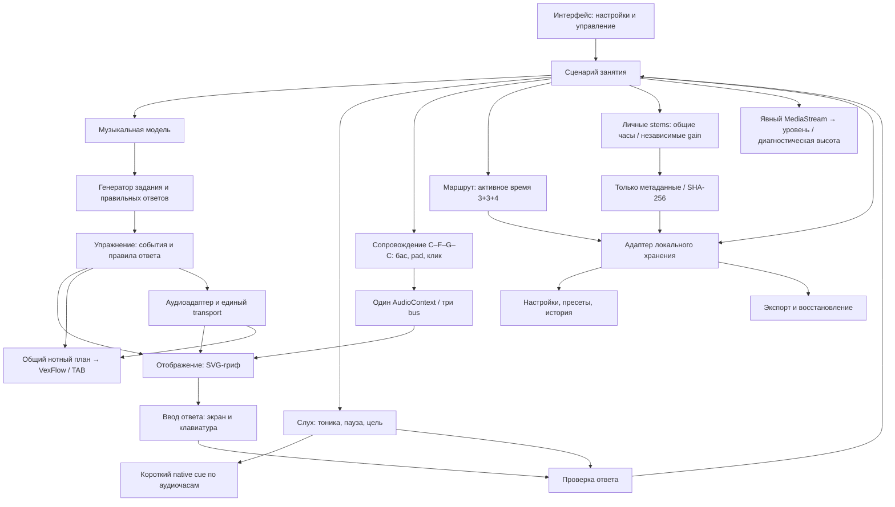

# Архитектура bass_study

Дата: 2026-11-08. Статус: **1.4.0 / P0–P8 выполнены в принятом программном объёме**. IndexedDB/JSON схемы 6 с миграцией 1–5, глобальным профилем и черновиками. Актуальная приёмка — [P8](verification/P8.md); историческая — [P7-04–06](verification/P7-04-06.md). Диагностический вход не означает калибровку настоящего инструмента.

В рабочей копии поверх этой базы реализованы общая оболочка и VIS-01 по D-030; собственная проверка — [P9](verification/P9.md). Это дополнение сохранило схему 6 и прежние зависимости. Последующая «Студия» раздела «Табулатура и ноты» со схемой **7** и корневой alphaTab 1.9.0 реализована по [D-032](DECISIONS.md#d-032) и проверена в собственном объёме [P10](verification/P10.md). Новый выпуск версии не объявлен.

Этот документ описывает текущее устройство приложения и принятые границы последующих компонентов. Цели находятся в [GOALS](GOALS.md), поведение и приёмка — в [REQUIREMENTS](REQUIREMENTS.md), порядок реализации — в [PLAN](PLAN.md), причины выбора — в [DECISIONS](DECISIONS.md). Основания исследования собраны в [RESEARCH](RESEARCH.md); фактические проверки и их пределы — в отчётах P1–P6, [P7-00](verification/P7-00.md), [P7-01](verification/P7-01.md) и [P7-03](verification/P7-03.md).

## 1. Архитектурные ориентиры

Подтверждённый сценарий — личные занятия на Windows-компьютере с клавиатурой, четырёхструнный бас E–A–D–G, приоритет грифа и основ. Соответствующие решения: D-001–D-003. Рабочий состав MVP закреплён в D-010, техническая основа — в D-011/D-013, границы компонентов — в D-012, training-модуль — в D-015, продуктовый аудиоплан и transport — в D-016, постоянные данные — в D-017. P6 развивает эту основу через D-018 (правила ответа/схема 2) и D-019 (writer lease/сохранение действий). Исходные предложения D-007–D-009 сохранены как заменённые записи. Порядок автономного продолжения задан D-014, ограниченные следующие модули — D-020.

Выбрано статическое приложение без обязательного удалённого backend. Корневое приложение запускается на `http://localhost:4173`; сервер `scripts/serve.mjs` слушает loopback `127.0.0.1` и при занятом порте завершает запуск с ошибкой, не выбирая другой origin. Отдельный стенд P1 использует тот же адрес и запускается вместо приложения, а не одновременно. Смена адреса или профиля требует явного переноса данных JSON-копией. Ресурсы приложения, включая синтез Tone.js, поставляются локально. GitHub хранит исходники и документацию, а не пользовательскую историю занятий.

Локальный HTTP-сервер раздаёт файлы и не становится сервером аккаунтов или облачного хранения. Сборка стенда P1 загружена в чистом профиле с отключённым кешем и блокировкой HTTP-запросов страниц стенда вне loopback; loopback оставался доступен. Сетевой адаптер Windows не отключался, фоновый сетевой трафик Windows не контролировался. Это подтверждает автономную загрузку проверенного стенда, но не заменяет будущую проверку полного занятия. PWA и service worker не нужны для выбранного способа локального запуска.

Открытие через `file://` не является обещанным способом запуска: модульные скрипты требуют корректной загрузки ресурсов; область хранения зависит от origin. `localhost`, `127.0.0.1` и разные порты нельзя считать одной базой пользовательских данных. Основания: [модули JavaScript](https://developer.mozilla.org/en-US/docs/Web/JavaScript/Guide/Modules), [IndexedDB](https://developer.mozilla.org/en-US/docs/Web/API/IndexedDB_API).

## 2. Компоненты и поток данных

Музыкальная модель реализована в `src/music/index.ts`, генерация/проверка заданий и последовательностей — в `src/training/index.ts`. `src/main.ts` владеет общими фильтрами и исследовательским грифом; `src/ui/training.ts` — экранной сессией, ответным грифом, сводкой и маршрутом; `src/ui/player.ts` — управлением практикой. Чистый `src/audio/plan.ts` задаёт музыкальную сетку, `src/audio/engine.ts` — Tone.js/Web Audio. Корневые package.json и lockfile относятся к приложению. `experiments/p1` остаётся отдельной исторической пробой; его IndexedDB не является продуктовым хранилищем.

Маршрут последовательности связан с продуктовым transport и звучащей позицией. `src/storage/model.ts` определяет схему/валидацию, `src/storage/index.ts` — нативный IndexedDB, `src/storage/memory.ts` — явно временный адаптер, `src/app/write-queue.ts` — очередь записей UI. `src/ui/history.ts` читает реальные данные и делегирует применение настроек/восстановление координатору `src/main.ts`; самостоятельных баз у контроллеров нет.

R-016 добавляет чистый `src/ear/index.ts`, короткий `src/audio/cue.ts` и `src/ui/ear.ts`. Отдельный `src/route/index.ts` считает активное время трёх блоков; `src/ui/route.ts` управляет планом/глобальной панелью. `main.ts` координирует выбранный раздел foundation/ear/route, остановку звучащей практики и общую очередь типизированной истории. Основание — [D-022](DECISIONS.md#d-022).

R-017 добавляет `src/harmony/index.ts` — чистый план четырёх тактов, `src/audio/harmony.ts` — native Web Audio и три независимых bus, `src/ui/harmony.ts` — раздел сопровождения с предпросмотром и микшером. В `activeModule` добавлен `harmony`. Корневой координатор допускает одного активного звукового владельца: перед стартом сопровождения останавливает cue/последовательность и наоборот. Отдельные адаптеры не запускают параллельные независимые занятия. Основание — [D-023](DECISIONS.md#d-023).

| Компонент | Ответственность | Граница |
|---|---|---|
| Музыкальная модель | Строй, высоты, позиции, гаммы, интервалы, написание нот | Чистые вычисления без DOM, аудиоконтекста и базы |
| Генератор | Выбор разрешимой цели, последовательности и множества ответов | Получает ограничения; не рисует и не запускает звук |
| Сценарий занятия | Режим, текущий шаг, повторы, темп, завершение и результат | Не содержит формул музыкальной теории или API IndexedDB |
| Проверка ответа | Сопоставление цели и пользовательского ответа | Не выводит качество игры из кликов или ручной отметки |
| Отображение | Гриф, подписи, состояния, доступное управление | Читает модель и позицию проигрывания; не задаёт аудиоритм |
| Аудиоадаптер | Запланированный звук, отсчёт, метроном, циклы, остановка | Не определяет правильные ноты задания |
| Хранение | Сохранение, чтение, миграции и резервная копия | Изолирует браузерную базу от учебной логики |

Типичный поток: настройки инструмента → допустимые позиции → цель и ответы → представление упражнения → ввод → проверка → результат занятия. Для проигрывания тот же материал преобразуется в музыкальные события. Режим изучения может работать без запуска звука.

Изучение: настройки → музыкальный API → SVG и карточка связей. Задания: допустимые позиции и структура → `startQuiz` → ответ/показ/пропуск → новая сессия → сводка и типизированная история через очередь. Последовательности: тот же контекст → `createSequence` → видимый маршрут → аудиоплан → звук и текущая позиция → подсветка; пользователь отдельно сохраняет ручную отметку. Выбор в изучении не считается ответом в задании или измерением игры на басу.

## 3. Музыкальная модель

| Понятие | Представление для реализации | Зачем разделять |
|---|---|---|
| Класс ноты | Число 0–11, где C = 0 | Все A относятся к одному классу, но могут звучать в разных октавах |
| Абсолютная высота | MIDI-номер звучащей ноты | Определяет октаву и эталонную частоту |
| Написание | Буква, знак альтерации и отображаемая октава | F♯ и G♭ могут звучать одинаково, но означают разные интервальные функции |
| Ступень | Ступень и альтерация относительно заданного контекста | Зависит от тоники/аккорда, а не только от позиции |
| Позиция | Устойчивая ссылка на струну и целый лад | Одну абсолютную высоту можно сыграть в нескольких местах |
| Инструмент | Упорядоченные струны с открытыми высотами и доступным диапазоном ладов | Генератор не должен быть привязан к нарисованным координатам |

Для основного инструмента звучащие открытые струны снизу вверх: **E1–A1–D2–G2**, MIDI **28, 33, 38, 43**. Номер струны интерфейса не должен зависеть от индекса массива: первая струна — G, четвёртая — E. Формула позиции: `midi = openStringMidi + fret`; частота при A4 = 440 Гц: `440 × 2^((midi − 69) / 12)`.

Внутри используется звучащая высота. Будущая обычная басовая нотация получает отдельное октавное преобразование при отображении. Табы показывают реальные струну и лад. Изменение тембра не должно незаметно менять эталонную октаву. Учебные источники и независимые примеры приведены в [RESEARCH](RESEARCH.md).

Гамма задаётся музыкальным контекстом и интервалами, а её позиции вычисляются для выбранного инструмента и диапазона. Контекстное написание не сводится к единому массиву диезных названий. Например, поиск звучащей C♯/D♭ может иметь одинаковые позиции, а задание на ♯4 от C должно подписывать F♯, не G♭.

### Реализованный интерфейс музыкального модуля

`src/music/index.ts` не импортирует DOM, звук или хранилище. Экспортируемые определения и результаты неизменяемы; невалидная MIDI-высота, неизвестная струна или некорректный диапазон вызывают объяснимую ошибку. Пустой массив струн допустим и даёт пустое множество позиций.

| Экспорт | Фактический контракт P2 |
| --- | --- |
| `BASS_STRINGS`, `STRUCTURES` | Строй E/A/D/G и шесть структур с интервалами и ступенями относительно мажорной шкалы. |
| `parseNote(name)` | Буква, альтерация, класс и нормализованное имя; ASCII/Unicode знаки, включая двойные, без суффикса октавы. |
| `pitchClass(midi)`, `midiToFrequency(midi)` | MIDI 0–127 → класс 0–11 и эталонная частота при A4 = 440 Гц. |
| `formatMidi(midi, name?)` | Научная запись с октавой написания; MIDI 36 может быть C2 либо B♯1. Несовпадающее с высотой имя отклоняется. |
| `getPosition(string, fret)` | Позиция `{id,string,fret,midi,pitchClass,naturalName,frequency}`; ID вида `E:5`, лад 0–24. |
| `getPositions(filter)` | Включительный диапазон и выбранные струны → позиции в устойчивом порядке E/A/D/G. |
| `createStructure(root, id)` | Контекстные ноты, формула и функции для major/natural-minor, обеих пентатоник и двух трезвучий. |
| `annotatePositions(positions, structure)` | К позициям добавляются `inStructure`, `isRoot`, `noteName`, `degree`; исходные объекты не изменяются. |

Внутренние `degree` используют `b3`/`b7`, отображаемая формула — ♭3/♭7. Это функции относительно мажорной шкалы, не порядковые номера нот в пентатонике. Полный перечень контрольных значений и результаты проверок находятся в [отчёте P2](verification/P2.md).

### Инварианты музыкальной модели и последующих заданий

- E/5 и A/0 имеют одну высоту A1, MIDI 33. При поиске A1 допустимы обе позиции, если обе разрешены фильтрами.
- E/0 и E/12 относятся к классу E, но имеют MIDI 28 и 40. В ответе на точную высоту они не взаимозаменяемы.
- Поиск «все E» на E/0–12 включает два ответа, а не один. Диапазон 0–11 содержит только нижнюю E.
- В гамме F major четвёртая ступень подписывается B♭; арифметическое совпадение с A♯ не заменяет контекстное написание.
- При струне E и ладах 0–3 генератор не выдаёт цель A: сначала строится множество доступных ответов.

## 4. Задания, ответы и музыкальные события

`src/training/index.ts` не импортирует DOM, аудио или хранилище. Он получает аннотированные позиции и музыкальную структуру и возвращает неизменяемые вопросы, сессии, результаты и маршруты. Звуковой план и формат хранения реализованы отдельными адаптерами; экспериментальный snapshot P1 не является форматом продукта.

Реализованный API:

| Экспорт | Контракт P3 |
| --- | --- |
| `createQuestion(config)` | Режим, scope и seed → разрешимый вопрос, исходный контекст, правило ответа и варианты. Пустой материал отклоняется. |
| `startQuiz(config, count)` | Вопросы и начальная сессия со статусом `active`; UI использует 10 по умолчанию и 1–30 вопросов. |
| `submitAnswer(session, answer, elapsedMs)` | Проверяет ответ и монотонное время, возвращает новую сессию; терминальная сессия повторно не оценивается. |
| `revealAnswer`, `skipQuestion` | Завершают текущий вопрос с отдельным исходом, без самостоятельного правильного ответа. |
| `nextQuestion`, `getQuizSummary` | Архивирование результата и переход; сводка раздельно считает самостоятельные, исправления, ошибки, показы и пропуски. |
| `createSequence(config)` | Материал и порядок → неизменяемый массив позиций/высот; один маршрут для предпросмотра и проигрывания. |
| `createManualPracticeResult(input)` | Отдельная ручная модель из `src/training/results.ts`: self-report, комфортный BPM 40–220, длительность, заметка и снимок контекста; не содержит correct/accuracy. Форма P5 передаёт время работы эталона, исключая отсчёт и паузы. |

Следующие концептуальные контракты показывают связь реализованного ядра с будущими музыкальными событиями:

| Операция | Вход | Выход |
|---|---|---|
| Построить доступные позиции | Инструмент, струны, границы ладов, музыкальные фильтры | Позиции с высотой, написанием и контекстной функцией |
| Создать задание | Доступные позиции, тип цели, сложность, порядок/seed | Формулировка, правило ответа, множество правильных ответов |
| Построить упражнение | Музыкальный материал, порядок, длительности | Упорядоченные события и границы повторяемого фрагмента |
| Проверить ответ | Задание, ответ, при необходимости время | Верность, объяснение и состояние завершения |
| Завершить занятие | Конфигурация, фактические ответы, ручные отметки | Раздельные измеренные и самостоятельно отмеченные результаты |

В текущих режимах имя проверяется как класс ноты, «найди» принимает любую подходящую позицию, «найди все» требует полное множество. Это не автоматически созданный отдельный режим точной октавы. Scope — выбранная структура или хроматика; поиск ступени допускает только структуру. Повтор найденной позиции не увеличивает попытки и результат. Генерация воспроизводима по seed; UI получает новый seed через `crypto.getRandomValues`, а тесты не подменяют генератор скрытыми правильными ответами.

Сессия проходит `active` → `review` → следующий вопрос/`finished`. Контекст фиксируется при создании. Первый ответ/время, исправления, события и исход хранятся отдельно; после ошибки правильный ответ не становится самостоятельным задним числом. «Найди все» считается самостоятельным только при полном наборе без ошибок и показа ответа. Сводка сохраняет исходный материал и относится к экранным действиям, а не исполнению на инструменте. `TrainingResult` различает `QuizResult` и `ManualPracticeResult`; ручная модель не попадает в точность экранного квиза.

P6 добавляет два явных правила ([D-018](DECISIONS.md#d-018)). `find-pitch` задаёт точный `targetMidi`; все допустимые позиции той же высоты принимаются, другая октава отклоняется. `find-interval` получает `intervalDegree` и принудительный хроматический scope; написание вычисляется относительно тоники, нажатая позиция проверяется по звуку. ♯4 и ♭5 от C ведут в одинаковые позиции, но показывают F♯/G♭ соответственно. Ответный SVG не раскрывает имена через ARIA. В P9 гриф изучения использует отдельную адаптивную геометрию и фиксированные крупные ноты; ответный гриф сохраняет собственное представление — [устройство P9](#p9-ui).

Смена общей конфигурации или режима завершает активную серию; возврат требует нового старта. Невалидный диапазон передаёт пустой контекст заданиям и убирает исследовательскую карту до исправления; прежняя корректная область не показывается как действующая. Во время квиза карта изучения, состав структуры и инспектор скрыты; имена/MIDI в ARIA ответного грифа не раскрывают решение. Полная форма и окно её показа разделены по [R-023/P9](REQUIREMENTS.md#r-023-p9).

Маршрут сортируется по уникальным MIDI, затем при совпадениях выбирает E/A/D/G и минимальный лад. Для `round-trip` четыре высоты дают `[1,2,3,4,3,2]`; повтор начинается с 1 без дублирования краёв. Группы по три перекрываются. Предпросмотр не запускает звук и не обещает оптимальную аппликатуру.

Событие аудиоплана связывает номер шестнадцатой сетки, фазу, проход, долю/такт, индекс и позицию ноты, BPM и признак клика. Начало и длительность не хранятся только в миллисекундах: transport переводит музыкальную сетку в аудиовремя, сохраняя структуру при смене BPM.

В первой версии ответы поступают через экран и клавиатуру. Самооценка «сыграл уверенно при таком темпе» хранится отдельно от измеренной точности экранного задания. Будущий аудиовход подключается как самостоятельный источник наблюдений. По высоте звука нельзя достоверно установить выбранную струну, аппликатуру или качество глушения.

### Слуховая сессия и активный маршрут

`src/ear` генерирует вопрос из 1/3/5 выбранного мажорного/минорного трезвучия в фиксированном регистре. Музыкальный план — три доли: reference, rest, target. Сессия неизменяемая; begin/complete/cancel listen, answer, reveal, skip и next имеют упорядоченные события. Первое полное прослушивание открывает ответы; replay считается отдельно, первый ответ отсчитывается от первого complete. Ошибка/показ не становятся самостоятельными задним числом. Сериализация воспроизводит эту логику по событиям, включая BPM/минимальное время конца.

`src/audio/cue.ts` использует native AudioContext и два коротких sine-голоса, планируемых по `currentTime`; отдельного Tone transport нет. Callback завершения наступает только по реальным аудиочасам. Run ID/token исключают устаревшее завершение отменённого cue. Stop/hidden отменяют голоса и неполное прослушивание; hidden сохраняет вопрос, но требует новый полный listen. Смена настроек/раздела архивирует фактическую сессию. Цель не попадает в question DOM/ARIA и скрыта у interrupted-записи глобальной истории; завершённый ответ/показ может её объяснить. Перед listen координатор прекращает другой эталон.

`src/route` — другой вид времени: `performance.now()` измеряет явно запущенный блок, без оценки звука/внимания. План `[180000,180000,240000]` ограничивает текущий блок; опоздавшее наблюдение не запускает следующие блоки автоматически. На границе статус `between` ждёт explicit next; manual/hidden pause исключают время до resume. Ранний next/stop оставляют фактические значения, а не заполняют план. `src/ui/route.ts` публикует управления/границы сразу и checkpoint раз в 5 секунд; одна session ID/metadata обновляется upsert. Пустой старт с нулевым активным временем не создаёт фиктивную запись.

Глобальная панель маршрута доступна при работе с грифом/слухом/последовательностью. Tick обновляет числовые поля без пересоздания панели; checkpoint сохраняет фокус/черновик истории. Кнопки навигации выбираются как `button[data-route-step]`: диагностический атрибут контейнера не является действием. При паузе/переходе остановка аудио делегируется координатору. Отчёт различает чистые проверки полного 600000-мс плана и реальные короткие браузерные интервалы.

## 5. Проигрывание и синхронизация

Реализованы чистый план `src/audio/plan.ts`, адаптер `src/audio/engine.ts` и контроллер `src/ui/player.ts`. План использует сетку шестнадцатых: четверть = 4 деления, восьмая = 2, шестнадцатая = 1. Один Tone.js transport контекста обслуживает ноты, отсчёт, метроном и границы проходов; внутри Tone native loop не включён, проходы определяет план. Одновременно UI владеет одним плеером.

Аудиособытия отправляются заранее относительно часов Web Audio. `getSnapshot()` выбирает последний кадр, время которого уже наступило; будущий callback не двигает видимую позицию. UI через `requestAnimationFrame` читает снимок и подсвечивает SVG и карточку маршрута по тем же ID/индексу. Таймер UI не задаёт момент звука. Основания принципа: [MDN sequencing](https://developer.mozilla.org/en-US/docs/Web/API/Web_Audio_API/Advanced_techniques), [Tone.js Accurate Timing](https://github.com/Tonejs/Tone.js/wiki/Accurate-Timing). Продуктовые проверки и границы доказательства находятся в [P4](verification/P4.md).

`createPlayer()` возвращает `start`, `pause`, `resume`, `stop`, `setBpm`, `setVolumes`, `getSnapshot`, `renderOffline` и `dispose`. Конфигурация получает существующие `AnnotatedPosition[]`, диапазон, длительность, BPM, отсчёт, повтор и метроном. Два синтезатора и независимые gain-шины баса/клика сходятся в общую шину с реальным анализатором. В offline-render шины разведены по двум PCM-каналам для независимой проверки; это проверочный API движка, не пользовательский экспорт аудио.

Семантика управления:

- **Старт:** после пользовательского действия активировать аудиоконтекст, подготовить инструмент и выполнить выбранный отсчёт. Отсчёт выполняется при новом старте, без повторения на границе цикла или при продолжении паузы.
- **Пауза/возобновление:** сохранить фактические ticks, отключить запланированный сигнал, отменить будущие кадры и продолжить без повторного отсчёта. Дробный offset передаётся через `Tone.TicksClass`: строка с дробными ticks в проверенной версии могла интерпретироваться как секунды. Отдельно проверена непрерывность сетки и маршрута, включая паузу до будущего старта.
- **Стоп:** отменить будущие callback, обнулить общую шину и освободить синтезаторы; сбросить позицию. Новый старт начинает выбранный фрагмент и выбранный отсчёт заново. В trace отменённые lookahead-события помечаются `cancelled`, а не выдаются за прозвучавшие.
- **Цикл:** внутренний полуоткрытый диапазон `[from,toExclusive)` соответствует включительным номерам первой/последней ноты UI. Один проход, бесконечный повтор и конечная лестница используют одну сетку без дубля границы.
- **Смена темпа:** ручная команда применяется на следующей ещё не отправленной четверти, последняя команда заменяет предыдущую до применения. `requestedAt` и аудиовремя применения различаются. В паузе BPM действует при продолжении; лестница меняет BPM на границе прохода и блокирует ручной темп до стопа.
- **Немые такты:** пропускать звук клика, сохраняя движение внутренней позиции. Возвращение клика не создаёт нового старта или отсчёта.
- **Конец:** запланированный конец переводит движок в `finishing`; голоса и позиция завершаются только при достижении аудиочасами `finishAt`. Раннее планирование не обрывает последний проход.

Контроллер при настоящем скрытии вкладки вызывает `pause('hidden')`; возврат оставляет плеер на паузе до явного продолжения. P4 повторно проверил это в отдельном Edge через CDP с `noDefaults: true` и фактическим переключением вкладок, без синтетического события. Сон Windows, смена устройства и произвольное внешнее приостановление аудиоконтекста отдельно не испытаны. Ограничения фоновых таймеров: [Page Visibility API](https://developer.mozilla.org/en-US/docs/Web/API/Page_Visibility_API).

Структурные настройки плеера фиксируются до стопа; ручной BPM обычного повтора и громкости доступны во время игры. Смена общей области/маршрута и выход из последовательностей останавливают плеер. Отключение визуального пульса убирает счёт, текущую ноту и обе подсветки. Space/Escape работают только вне интерактивных элементов.

Тестовый `window.p4` существует только в изолированной fixture, импортирующей фактический движок через Vite; в продуктовом UI глобального тестового API нет. Независимые ожидания PCM, реальные live-уровни, будущие/наступившие события, сетка после паузы и пользовательские действия проверяются раздельно. Числовые результаты и исправления принадлежат [отчёту P4](verification/P4.md), а не этому описанию устройства.

Поддержка аудиоконтекста и задержка зависят от браузера и устройства; `latencyHint` — пожелание, а не гарантированная величина. Числовые обещания точности и автоматическая оценка игры появятся только после измерений. [MDN: AudioContext](https://developer.mozilla.org/en-US/docs/Web/API/AudioContext/AudioContext).

## 6. Хранение и восстановление

Продукт использует нативный IndexedDB за узким адаптером (D-017/D-018/[D-023](DECISIONS.md#d-023)). База `bass-study`, текущая версия **5**, содержит `preferences` (ключ `current`), `presets` и `history` (ключ `id`). Обычная запись затрагивает только свой store; сохранение настройки не перезаписывает историю. Проба P1 использует другую базу. IndexedDB асинхронна и привязана к origin. [MDN: IndexedDB](https://developer.mozilla.org/en-US/docs/Web/API/IndexedDB_API).

### Схема и достоверность

`StudySnapshot` — `{format: 'bass-study-backup', schemaVersion: 5, preferences, presets, history}`. `AppPreferences` содержит изучение/квиз/последовательность/плеер, `activeModule`, `ear` (root/quality/count/bpm) и `harmony` (bpm/countIn/repeat и три пары volume/muted), `tracks` (null либо переносимый манифест) и `input` (deviceId); пресет сохраняет весь набор. Границы фрагмента в копии — включительные номера с 1 либо `null`; плеер проверяет их на фактическом маршруте. Экранные вопросы содержат `targetMidi`: конкретную высоту для find-pitch либо `null` для остальных режимов.

Каждая запись истории имеет ID, `occurredAt` в UTC, `timeZone` и `localDate`, вычисленную в исходном поясе. Исторический день не пересчитывается при смене пояса просмотра. `screen-input` хранит seed, режим, контекст один раз и вопросы с ответами/временем/исходами. Валидация воспроизводит правила по событиям ответа и отклоняет противоречивую самостоятельность, неверную цель и позиции вне контекста. Прерванная сессия сохраняет реальные действия с исходом `interrupted`; пустая не создаёт фиктивную историю. `self-report` сохраняет ручные комфортный BPM/заметку и длительность работы эталона, без accuracy/correct.

`ear/audio-choice` сохраняет исходные root/quality/seed, вопрос, start/complete/cancel прослушивания, replay и ответы/исход. `route/active-timer` содержит план/фактическое время блоков, события управления, статус/причину конца; у него нет accuracy. Сводки screen/manual/ear/route разделены. Metadata фиксируется за сессией и не пересоздаётся при autosave; reload оставляет историю, но не возобновляет старый cue/таймер автоматически.

Длительность черновика считает фактическое время практической фазы текущего аудиозапуска, исключая отсчёт, паузу и будущий lookahead. После успешной записи вычитается захваченная длительность; остаток, накопленный за время записи, остаётся. Ключ контекста защищает от вычитания в новом маршруте. Время эталона не подтверждает игру пользователя на басу.

`model.ts` проверяет plain JSON, обязательные/лишние поля, типы/диапазоны, ID, музыкальные ссылки, даты и согласованность событий. Компактная копия ограничена 64 МиБ UTF-8, без аудиофайлов/встроенной библиотеки. Предел не гарантирует RAM/квоту. Принимаются версии 1/2/3/4/5, экспорт выдаёт 5. Версия 1 получает intervalDegree/targetMidi прежнего перехода, схемы 1/2 — activeModule foundation и ear по умолчанию; переход 3 → 4 добавляет harmony по умолчанию, 4 → 5 — tracks=null и input.deviceId пустой в настройки/пресеты. Исходные события/даты и четыре типа истории сохраняются; старые форматы не допускают подмешанный новый тип. JSON преобразуется до preview, без записи до подтверждения.

Для существующих баз 1/2/3/4 `onupgradeneeded` обходит три stores курсорами и обновляет их одной versionchange-транзакцией. Ошибка записи отменяет весь upgrade без сброса старой базы. Буквальные `tests/fixtures/v1-backup.json`, `v2-backup.json`, `v3-backup.json`, `v4-backup.json` независимы от новых фабрик; настоящие старые базы/сырые снимки проверяют upgrade 1/2/3/4 → 5 и отказ, а не roundtrip уже новой схемы.

### Координация и восстановление

По [D-021](DECISIONS.md#d-021) нативный адаптер хранит замороженный подтверждённый снимок после первого полного чтения/валидации. `readSnapshot()` возвращает эту известную версию одному пишущему приложению; `readSnapshot({fresh:true})` явно читает и валидирует IndexedDB. Записи/удаления обновляют кеш только после commit, заменяя изменённые записи/настройки без повторного чтения и воспроизведения всей истории. `restore` меняет кеш только после успешной общей транзакции. При abort/quota старый снимок остаётся; неуспешное принудительное чтение не оставляет старый кеш якобы актуальным.

`close`, `versionchange` и неожиданное событие `close` инвалидируют снимок. Обработчик привязан к конкретному соединению, чтобы позднее закрытие старого соединения не удалило новое. Прямой внешний писатель вне продуктового lease может сделать известный кеш устаревшим: `fresh:true` — явная граница проверки внешних изменений, а не обещание автоматической синхронизации. Очистка браузерной базы проверена только на изолированном тестовом origin; следующее чтение возвращает пустую базу, а не прежние записи.

На старте `main.ts` делает контролы `inert`, читает снимок, применяет его под `applyingPreferences`, затем разрешает управление. Контроллеры предоставляют `getPreferences`/`applyPreferences`; применение не вызывает обратное автосохранение. Один координатор связывает завершение квиза, ручную форму и настройки с `createWriteQueue`. Очередь сериализует записи, ждёт добавленные из завершений операции и хранит ошибки до успешного повтора. Ошибка истории не исчезает после посторонней удачной настройки. Невалидное незавершённое поле не записывает старое значение как будто новое принято.

По D-019 перед открытием управления приложение получает эксклюзивный Web Lock `bass-study:writer` с `ifAvailable`. Вторая вкладка блокирует контролы и предлагает явную повторную загрузку после закрытия первой; совместное редактирование не обещается. При `pagehide` retiring guard запрещает новые записи и повтор сохранения, останавливает плеер, завершает очередь, закрывает адаптер и затем освобождает lease. Инициализация после каждого ожидания учитывает уход страницы; bfcache-возврат перезагружается. Сохранность не основывается на обещании браузера дождаться async unload: экранные ответы сохраняются сразу после каждого фактического действия, а статус сообщает о завершении записи.

`onSessionChanged` и `onSessionFinished` используют один metadata ID для неизменяемого массива вопросов, созданный при первом действии. Каждый снимок upsert обновляет ту же запись. Незавершённый ответ сохраняет реальные события как `interrupted`; новый старт получает другой массив/ID. Это не восстановление активного квиза с прежним таймером: после reload история остаётся, для ответа начинается новая серия. Чтение scope последовательности выделено в узкий getter, чтобы неверный count квиза не ломал независимую историю/ручную форму.

Экспорт/чтение истории/просмотр импорта дожидаются очереди. При наличии неуспешных операций экспорт доступен, но UI прямо сообщает, что он содержит только подтверждённые записи. `previewImport` целиком проверяет JSON и показывает число пресетов/записей с предупреждением о замене. До подтверждения не меняются данные, параметры или занятие; отмена очищает только preview. После подтверждения координатор останавливает плеер, закрывает экранную сессию с реальным исходом, дожидается записей, вызывает `restore` и применяет восстановленные настройки под guard.

`restore` выполняет очистку трёх stores и запись всего снимка в одной `readwrite` транзакции. При abort даже после успешного первого put действуют прежние данные; слияния нет. Исходная копия остаётся экспортируемой до подтверждения. В тесте rollback используется фактический `transaction.abort()`, а не отказ предвалидации.

Если исходная база не открылась при запуске, координатор выбирает `createMemoryStudyStore`, не сбрасывает базу и постоянно показывает временность режима; экспорт памяти доступен. Обычная ошибка записи не переводит приложение молча в память. Квота и очистка браузерных данных не гарантируют долговременную сохранность; нужна внешняя копия. [MDN: квоты и удаление](https://developer.mozilla.org/en-US/docs/Web/API/Storage_API/Storage_quotas_and_eviction_criteria).

P5 проверил нативные записи, полный перезапуск браузера с тем же профилем, чистое восстановление, отмену, валидацию, abort после успешного put, отказ браузерной квоты и повтор. Память испытана отдельно и не выдаётся за IndexedDB. Квота задавалась CDP для тестового origin, физический диск не заполнялся. P6 проверил фактический upgrade/rollback версии 1, старый JSON и исключение второго писателя; окончательная приёмка и свежие регрессии — в [отчёте P6](verification/P6.md).

## 7. Представления и управление

Гриф реализован в SVG: G/D/A/E сверху вниз, отдельный доступный элемент `role=button` для каждой позиции, открытые струны и включительный диапазон. Гриф изучения P9 переносит весь выбранный диапазон на последовательные подписанные части, сохраняя крупные ноты и четыре струны в каждой. Фокус и выбранная позиция различаются: стрелки/Home/End перемещают фокус, Enter/пробел выбирают. В Tab-порядке остаётся одна позиция грифа. Струны и границы имеют обычные поля; видимые picker тоники/структуры/формы опираются на прежние select и события `change`, подписи управляются кнопками. Подробности — [P9](#p9-ui).

Тоника, выбранная позиция и совпадение по высоте имеют разные обводки и доступные подписи. Карточка показывает звучащую ноту, роль и струну/лад, техническое раскрытие — MIDI и частоту; связи различают ту же высоту и другие октавы. Пустой фильтр оставляет четыре пустые струны с объяснением. Неверный диапазон убирает прежнюю карту, выделение и зависимые связи, показывает ошибку и блокирует новые задания до исправления.

Режимы «Изучение», «Задания», «Последовательности» разделяют сценарии. У квиза отдельный ответный SVG без названий нот до показа, клавиатурная навигация и переход фокуса к следующему вопросу после завершения. Ошибка, частичное нахождение, исправление, показ и пропуск видны текстом. В последовательностях есть предпросмотр и плеер. Свёрнутый раздел «Мои занятия и настройки» содержит историю, ручную отметку, пресеты и перенос данных; ошибка сохранения видна и при закрытом разделе.

P7-00 откладывает построение тела панели до её открытия. Подтверждённые upsert сохраняют ID сессии; после открытия видны последние собственные commit. Производные сводки/группы переиспользуются, пока ссылка на неизменяемую историю не меняется; они вычисляются из уже проверенных записей, без повторной валидации всех попыток. При изменении открытой истории сводки пересчитываются, поэтому это не обещание постоянной стоимости при любом размере. Первое полное чтение/валидация по-прежнему проходит на главном потоке и остаётся ограничением большого снимка. Измерения и сравнение — только в [P7-00](verification/P7-00.md).

Повтор ошибок группируется по исходным контекстам. Координатор восстанавливает исходные тонику/структуру и область, затем `setReviewPositions` ограничивает ответный гриф точными ID. Режим — называние ноты, scope хроматический; баннер объясняет набор, очистка возвращает обычные вопросы. Смена общего контекста снимает ограничение. Результат этого повторения остаётся отдельной экранной сессией.

Горячие клавиши не должны перехватывать ввод чисел и текста в настройках. Основные действия доступны обычными кнопками. Режим изучения, экранная проверка и игра вместе с эталоном имеют различимые состояния, чтобы пользователь понимал, что именно измеряется.

TAB и нотный стан получают позиции и длительность существующей последовательности, а подсветку ведёт её фактический аудиоиндекс. SVG-гриф и нотационная библиотека выполняют разные задачи. По [D-024](DECISIONS.md#d-024) принят VexFlow 5.0.0 как локальный renderer без собственного проигрывателя. Расширенный импорт партитур остаётся идеей R-015; рассмотрение [alphaTab](https://github.com/CoderLine/alphaTab) потребует отдельного решения о взаимодействии с существующими аудиочасами.

## 8. Принятая техническая основа

Версии приложения закреплены корневым `package-lock.json`: TypeScript **7.0.2**, Vite **8.3.6**, Vitest **5.1.0**, Playwright **1.65.0**, Tone.js **15.1.22**, VexFlow **5.0.0**. Tone импортируется продуктовым аудиоадаптером и включён в локальную сборку; для P5 новых зависимостей нет. У P1 собственный lockfile. Проверены Windows 11 Pro (10.0.26300), Edge **157.0.4341.42**, Node **24.18.0**, npm **11.16.0**. Chrome и другие браузеры не испытывались.

| Задача | Принятая основа и статус | Альтернатива и условие пересмотра |
|---|---|---|
| Язык и сборка | [TypeScript](https://www.typescriptlang.org/docs/) **7.0.2** + [Vite](https://vite.dev/guide/static-deploy.html) **8.3.6**; корневое приложение собирается | Изменение сборщика требует выявленной проблемы; JavaScript ослабит проверку музыкальных контрактов |
| Интерфейс и гриф | Реализованы семантический HTML, CSS, DOM и SVG | UI-фреймворк выбирать при доказанной сложности состояния |
| Звук | Tone.js **15.1.22** для последовательности; native Web Audio для cue/сопровождения/дорожек/входа, каждый за адаптером | Один активный звуковой владелец; реальные PCM/lifecycle проверяются отдельно, физическая задержка не обещается |
| Локальная база | Нативный IndexedDB за адаптером, схема/валидация и атомарная замена P5 | Маленькая оболочка допустима при доказанной сложности миграций, без изменения доменной модели |
| Нотация и TAB | VexFlow **5.0.0**, ленивый `vexflow/bravura` с локальными шрифтами, общий индекс последовательности; R-018 реализовано | alphaTab рассматривать при необходимости импорта Guitar Pro/MusicXML и проверки взаимодействия с аудиочасами |
| Проверки | [Vitest](https://vitest.dev/guide/) **5.1.0** — музыка, training, аудиоплан, схема и очередь; [Playwright](https://playwright.dev/docs/intro) **1.65.0** + Node assert — UI, Web Audio, нативная IndexedDB и сквозной сценарий | Состав и числа P1–P6 находятся в отчётах; новые модули получают отдельную приёмку |

Tone.js выбран по достаточности проверенной пробы циклов и ручного темпа; адаптер ограничивает зависимость учебной логики от библиотеки. Официальный проект описывает transport и синтез поверх Web Audio: [Tone.js](https://github.com/Tonejs/Tone.js). Воспроизводимые команды, условия запуска и полный результат находятся в [отчёте P1](verification/P1.md). Сборка стенда не подтверждает готовность музыкальных упражнений или качество тембра на акустике пользователя.

## 9. Состояние технических рисков версии 1.3.0

| Вопрос | Что проверено | Что остаётся |
|---|---|---|
| Браузер | Edge 157.0.4341.42: P1–P6, полный сценарий с клавиатурой и перезапуском | Chrome отдельно до обещания поддержки; скринридер и телефон не испытаны |
| Музыкальная модель и гриф | Независимые расчёты/написание/фильтры, точная высота/произвольный интервал, выбор и фактическая звуковая подсветка | Пользовательская полезность на длительных занятиях и новые контексты P7 |
| Задания и последовательности | Шесть экранных режимов, слух 1/3/5, активный маршрут, независимые исходы/история и точный повтор ошибок | Сопровождение R-017 проверено отдельно; нотация/файлы/программный вход приняты в P7-04–06; учебная эффективность требует личных занятий |
| Способ запуска | Статическая сборка, localhost:4173, launcher после подготовки, отказ при занятом порте, изоляция внешних запросов и перезапуск браузера/сервера | Запуск после перезагрузки Windows, установка Node.js без участия пользователя не обещается |
| Звуковая основа | Реальный сигнал в Analyser и offline-PCM; тишина после stop | Физические динамики, восприятие низких нот, аудиовыходная задержка и подбор громкостей |
| Работа transport | Продуктовые отсчёт, цикл/фрагмент, дробная пауза, ручной BPM/лестница, немые такты, подсветка, стоп/перезапуски и реальное скрытие вкладки | Длительное занятие, sleep/resume ОС и смена аудиоустройства |
| Восстановление | Схема 5/копии 1/2/3/4, native upgrade/rollback, атомарная замена, кеш/fresh/raw, quota/clear и один writer; ear/route roundtrip | Первое полное чтение блокирует главный поток; годовая модель P7-00 проверялась на схеме 2, расширенный масштаб новых типов отдельно не измерен |
| Нотация и аудиовход | Чистая басовая модель/рендерер и диагностический input приняты по геометрии/синтетике/native fake-device/UI | Реальный бас/USB, устойчивость в фоне и сквозная задержка не измерены; автоматической оценки нет |

P6 принял базовый MVP, P7-00 — кеш/компактную копию, P7-01/P7-02 — слух/маршрут, P7-03 — сопровождение/схему 4; P7-04–06 добавили нотацию, дорожки и программную диагностику входа/схему 5. Прежние raw остаются историческими; новые числа/пределы — в [P7-03](verification/P7-03.md), дальнейшая работа — в [плане](PLAN.md). Программные проверки R-018–R-020 собраны в [P7-04–06](verification/P7-04-06.md); физическая калибровка входа остаётся отдельным ограничением.

### Сопровождение: часы, пауза и ручной результат

`createHarmonyPlan()` задаёт 16 четвертей, 16 басовых нот, 12 нот pad и 16 кликов. У каждого события собственные beat/duration и принадлежность такту; звучащая высота и строка/лад берутся из музыкальной модели. `createHarmonyPlayer()` планирует три bus в одном AudioContext с опросом 25 мс/горизонтом 100 мс; это параметры scheduler, не измерение физической точности.

Снимок сравнивает событие с фактическим currentTime. Дробная pause фиксирует offset, отменяет будущие голоса; resume восстанавливает только оставшийся хвост активных баса/pad и продолжает четвертную сетку без нового count-in. Последний scheduled event переводит finite-проход в finishing; finished наступает только по actual finishAt. Сильное опоздание scheduler ставит практику на timing-паузу вместо серии догоняющих нот. Hidden требует явного продолжения, уход из раздела — stop.

Микшер меняет GainNode отдельных голосов без перезапуска часов. BPM/count-in/repeat блокируются до stop. UI показывает четыре карточки/16 позиций и actual highlight; они не обещают лучшую аппликатуру. Offline renderer выдаёт три отдельные PCM-канала для независимой проверки баса, pad и клика, не три раздельных transport.

Ручной черновик фиксирует контекст C major/EADG0–12, подпись C–F–G–C и фактическую длительность эталона без count-in/пауз. После успешного сохранения вычитается только зафиксированное время. Runtime epoch меняется при замене материала/применении настроек и защищает новый запуск от расходования старым черновиком. Старый ввод остаётся связан со своим исходным материалом до явного действия пользователя; тип результата по-прежнему self-report, без accuracy.

### Нотация: представление общего плана

`src/notation/index.ts` преобразует проверенные позиции в неизменяемые события: sounding/written MIDI, написание, диатоническая ступень на стане, альтерация с состоянием внутри такта, длительность и строка/лад TAB. `src/ui/notation.ts` строит SVG через ленивый VexFlow 5.0.0 с локальными Bravura/Academico. Гриф и renderer — разные компоненты. Одинаковая высота E/5 и A/0 остаётся одной нотой на стане и разными табовыми позициями. Основной player передаёт фактический `noteIndex`; stop/hidden/context change снимают подсветку. Клик/клавиатура возвращают выбранный индекс координатору. Нет второго transport, загрузки партитур или записи PCM. Основание — [D-024](DECISIONS.md#d-024).

### Личные дорожки: метаданные отдельно от аудиобуферов

`src/tracks/index.ts` валидирует переносимый `TracksManifest` и общий план сегментов. `src/audio/tracks.ts` владеет AudioContext, декодированными буферами и всеми AudioBufferSourceNode; у каждого stem свой GainNode, общие старт/clip/rate и конец цикла. Позиция вычисляется по фактическому `currentTime`, короткий stem не сдвигает цикл. Будущие sources отменяются при pause/stop/seek; продолжение начинает все доступные stems с одной source-position. Скорость 0.5–1.5 — varispeed, меняющий высоту; это не time-stretch.

Загрузка сначала декодирует и проверяет весь следующий набор, затем заменяет старый. Token отбрасывает поздний decode после cancel/ухода/restore; сам native decode может завершиться позднее. Манифест хранит SHA-256/размер и параметры, но `File`, `Blob`, PCM и object URLs не входят в IndexedDB/JSON. `restoreManifest` сбрасывает все привязки; повторный выбор точных байтов допускает другое имя. Предел расчётного decoded PCM не равен пиковому расходу памяти, поскольку прежние и временные буферы могут сосуществовать. Основание — [D-025](DECISIONS.md#d-025).

### Диагностический вход: запрос, анализ, освобождение

`src/audio/input.ts` изолирует navigator.mediaDevices и реальный граф: stream → raw analyser для уровня, stream → low-pass 1 кГц → pitch analyser; обе ветви заканчиваются GainNode с gain 0. Объект/список устройств не вызывают getUserMedia, только явный start. Запрашиваются mono ideal и выключенные echo/AGC/noise suppression; фактические getSettings показываются отдельно и могут отличаться. В снимке нет обещания измеренной производительности устройства.

`src/input/pitch.ts` принимает полный монофонический кадр 8192 при 44.1/48 кГц. YIN-inspired difference/CMND/порог и интерполяция дополнены собственными отказами тишины, атаки и некоторых гармонических неоднозначностей. Диапазон отчёта 35–350 Гц, confidence — эвристика. Это не идентификатор струны/лада, не детектор ритма и не аудиозачёт. Окно анализа/выходной baseLatency не означают входную сквозную задержку.

Токен защищает pending permission/resume: stop/hidden/уход/restore/смена выбора закрывают поток/контекст; поздний полученный поток тоже останавливается. ended/device disappearance/interrupted context дают явную ошибку без автоматического reconnect. `src/ui/input.ts` сохраняет только deviceId и не подключается после reload/apply. Корневой координатор останавливает другие звуковые владельцы перед стартом входа. Основание — [D-026](DECISIONS.md#d-026); измерения настоящего баса/USB — отдельный протокол [P7-04–06](verification/P7-04-06.md).

## P8: профиль, формы и черновики схемы 6

Исторический объём P8 по [D-027](DECISIONS.md#d-027): `src/music/boxes.ts` — чистый версионированный каталог boxes-v1. Обычные задания и последовательности получают точные `referencePositionIds` полной формы; find-interval — её хроматический прямоугольник без слоя бокса. Любой гриф показывает четыре строки G, D, A, E; неиспользуемые остаются пустыми. `study.showFingers` хранит показ пальцев отдельно от ступеней, исходно выключенный. Начальный материал — A minor pentatonic, форма A на ладах 5–8. P9 сохраняет эти музыкальные правила, отделяет окно показа 0–12 от формы и уточняет подписи/контролы — [актуальное представление](#p9-ui).

`src/route/index.ts` сохраняет неизменяемый общий материал, политику шести вопросов и ссылки результатов. Рекомендуемый материал — C major triad с тоникой E/8; свободный материал фиксирует выбранные позиции, порядок, включительный фрагмент и настройки плеера. Карточки блоков открывают свободный просмотр с `onGo(step, null, false)` после паузы; возобновление или следующий шаг передают действующий снимок и `routeRef`. `src/ear/index.ts` принимает явную опору `referenceMidi`; маршрут берёт её из материала, свободный слух сохраняет прежний фиксированный регистр. Неизвестный материал старого маршрута хранится как `material:null` с пустым `sessionLinks`; `{kind:'legacy-unknown'}` применяется только к старым ручным отметкам.

`src/storage/contracts.ts` задаёт `GlobalProfile`, `PracticeDraft` и `DrainDraftRequest`; model строго валидирует схему 6, реализации IndexedDB и memory поддерживают одинаковые операции. Хранилища IndexedDB: preferences, presets, history, profile, practiceDrafts. Каждая миграция 1–5 и полный restore проходят общей транзакцией; кеш меняется после commit. Атомарный drain создаёт ручную отметку и продвигает `recordedThroughMs`. Неизменяемый материал и `editRevision` не позволяют старому checkpoint вернуть уже учтённое время или затереть новый текст.

`src/app/practice-drafts.ts` связывает неизменяемый материал и локальный день с настоящими часами действующего плеера. Он отслеживает дельты, сохраняет текст через 300 мс после ввода, время — каждые 5 с и на границах действий; запрос Save сохраняет устойчивый ID. После перезапуска загружаются только данные, без запуска аудио, таймера или входа. Корневой координатор выполняет flush до export, restore и смены материала, управляет поколениями удаления в write-queue. Старая ошибка записи не очищается до успешной актуальной операции.

`src/app/theme.ts` меняет `data-theme`, семантические CSS-роли и сохраняемый выбор профиля; музыкальные пресеты не содержат профиль. Ранний код в index.html проверяет узкий версионированный кеш localStorage; профиль IndexedDB имеет приоритет. Подтверждение кеша следует за commit. VexFlow использует отдельные ink, paper и masks; прозрачность и единственный курсор сохраняются. `src/ui/introduction.ts` содержит неоцениваемые управляемые действия и cue, включённый корневым координатором в общее управление звуковым владельцем. Подтверждение удаления — общий нативный dialog `src/ui/confirm.ts`, с отменой по Escape и возвратом фокуса.

## P9: устройство общей оболочки и VIS-01

По [D-030](DECISIONS.md#d-030) пользователь утвердил [VIS-01-A3 r5](design/screens/01-fretboard.md) и поручил перенести общую оболочку и экран изучения грифа в продукт. Ниже описан реализованный код; P9-10–12 выполнены в границах [продуктовой проверки P9](verification/P9.md). Контракт поведения — [R-023/P9](REQUIREMENTS.md#r-023-p9), задачи — [P9](PLAN.md#p9). Остальные разделы сохраняют входы и существующие контроллеры; их полный редизайн отложен до функциональной переработки.

`src/main.ts` координирует левую навигацию, панель материала, выбор/фокус и прежние контроллеры. [src/ui/fretboard.ts](../src/ui/fretboard.ts) — чистый SVG-рендерер грифа: он получает окно показа, позиции, точную форму, выбранную/активную ноту и независимые слои. Ноты материала и выбранная позиция имеют маркер 46 px и подпись 18 px, остальные доступные позиции — тихие точки. При нехватке ширины весь диапазон распределяется по последовательным подписанным частям, каждая содержит G–D–A–E. Невалидное окно даёт явное пустое состояние вместо прежней карты. Фокус, выбор, звучание, тоника, палец и пересечение соседних форм остаются разными состояниями.

[src/music/octaves.ts](../src/music/octaves.ts) вычисляет октавные участки по звучащим MIDI и структуре, без DOM и хранения. Полнота требует всех её ступеней и двух граничных тоник; физические дубликаты не восполняют недостающую высоту. Источник материала и видимые позиции передаются отдельно: так различаются полный материал, частичный показ и исходный фрагмент. Одна граничная тоника сама не создаёт участок. Рендерер рисует мягкие подложки и разделённую общую границу вокруг одного маркера, без суммирования прозрачности. [src/ui/study-details.ts](../src/ui/study-details.ts) отдельно формирует выбранную ноту/техническое раскрытие, подписанную пару «Интервал от тоники» и группы «Та же высота» / «Другие октавы» с переходами. Линия на грифе появляется для видимой пары в одной части; текст интервала не зависит от возможности провести её через разные части.

[src/ui/select-picker.ts](../src/ui/select-picker.ts) оформляет существующий одиночный `select` кнопкой и `listbox`, сохраняя его значение и обычное событие `change`. Нативный элемент исключён из Tab/дерева доступности; управление идёт через видимый trigger и варианты. Стрелки учитывают четыре колонки тоник, Home/End выбирают границы фокуса, Enter/Space подтверждают, Escape возвращает фокус, Tab закрывает список. Поддерживаются поиск набором текста и закрытие щелчком вне списка. `MutationObserver` синхронизирует варианты и disabled; `dispose()` возвращает исходный select и снимает обработчики.

Данные сохраняют схему 6: `study.fretMin/fretMax` задают окно отображения, исходно 0–12; прежние сохранённые значения остаются прежними. `box` хранит полную форму. Смена тоники, структуры или формы сохраняет окно, ручная правка струн включает свободную карту. При форме обычные задания/последовательности используют её точные позиции, а `practiceFullPositions()` отдаёт find-interval хроматический прямоугольник самой формы. Отображаемая область не расширяет учебное множество. Видимость панели, интервального/октавного слоёв и пересечения соседа остаётся состоянием текущей страницы; `showFingers` по-прежнему входит в настройки материала.

Две кнопки темы показывают разрешённые светлую/тёмную темы. `system` остаётся допустимым профилем/импортом и реагирует на системную схему до явного выбора; разрешение темы не пишет в профиль. Явный выбор сохраняет `light`/`dark` прежней очередью с подтверждением раннего кеша после commit. Смена темы меняет представление и не пересоздаёт звуковые/учебные контроллеры.

История открывается через `#open-history`; закрытие навигацией или summary скрывает mount и возвращает фокус из него. `src/ui/history.ts` строит карточки только при открытой панели, собственные commit/upsert остаются в подтверждённом снимке. Спокойный статус сохранения находится внизу навигации; ошибка или временная память выводятся видимым баннером, retry и экспорт сохраняют прежние гарантии. Введение применяет C major triad, сохраняя прежнее валидное окно и расширяя его при необходимости. Явный запуск маршрута восстанавливает валидный вид после ошибочного ввода; переход из нотации «Показать на грифе» расширяет окно до выбранной ноты только по этому явному действию. Перемещение фокуса в нотах не меняет окно.

Эта часть уточняет поведение P8, сохраняя его историческое описание и приёмку выше. Новых зависимостей и миграции схемы для переноса нет. Автономные HTML и модель r5 — неизменный визуальный ориентир; продукт использует собственную музыкальную модель, transport и хранилище. [P9](verification/P9.md) фиксирует 360 unit и 222 браузерных сценария, доказательства и оставшиеся ограничения; это проверка рабочей копии, а не объявление нового релиза.

## Исследовательская проба свободного музбанка

По [D-029](DECISIONS.md#d-029) будущий музбанк [R-024](REQUIREMENTS.md#r-024) допускает свободное управление всеми партиями, а направление [R-025](REQUIREMENTS.md#r-025) заменяет фиксированный сценарий сопровождения метрономом и ритм-секцией. Продуктовая реализация 1.4.0 и исторические приёмки выше этим решением не удаляются и не расширяются автоматически.

[Стенд P10-00](../experiments/music-bank/README.md) изолирован от src, корневых зависимостей и IndexedDB продукта. Его собственный package-lock.json закрепляет alphaTab 1.9.0. Сервер loopback раздаёт только UI, локальные ресурсы npm-пакета и ограниченную выборку исходных файлов по ID с проверкой SHA-256; исходники остаются в пользовательской папке. ScoreLoader читает структуру партитуры, alphaTab рисует ноты/TAB и ведёт собственный синтезатор/курсор. Это отдельный эксперимент, а не второй параллельный транспорт основного приложения.

UI хранит видимость и микшер отдельно. В исходной P10-00 штатные mute/solo/volume alphaTab адресовали общие MIDI-каналы и связывали несколько ударных партий. Группировка объясняла проблему, но не заменяла независимость R-024. Этот исторический результат сохраняется в отчёте; следующая доработка описана ниже.

Browser runners разделяют DOM/курсор, короткий экспорт PCM с явным микшером и живой сигнал AudioWorklet через дополнительный AnalyserNode только тестового initScript. Они не меняют звуковой граф продукта и не сохраняют PCM. Результаты и границы приведены в [отчёте](verification/MUSIC_BANK_PROBE.md); успешная выборка не утверждает совместимость всего каталога или выбор библиотеки для продукта.

### Музбанк r1: виртуальные каналы и постоянная рабочая область

По [D-031](DECISIONS.md#d-031) стенд использует локально изменённую ESM-поставку exact alphaTab 1.9.0. Postinstall вызывает `prepare-vendor.mjs`, сверяющий исходный SHA-256/версию и именованные замены. В ignored generated-vendor копируются worker/worklet/font/soundfont и лицензии, core генерируется с отметкой изменений. Единая `channel-layout.mjs` назначает непересекающиеся пары мелодических каналов и ударные 9+16*n. Synth/sequencer/transpose распознают все эти ударные; exclusive-class choke и velocity-0 note-off ограничены собственной партией. Два канала специальных приёмов одного мелодического инструмента сохраняют общую семантику. Смешанный ударный/мелодический track пока отвергается; виртуальные номера не экспортируются в стандартный SMF.

При успешной смене файла сброс пользовательских mute/solo выполняется **перед** renderScore, чтобы убрать solo даже у отсутствующего в новой песне старого канала и сохранить заново вычисленную транспозицию. После midiLoaded все текущие mute/solo/громкости явно применяются из UI-state: движок сохраняет часть overrides между MIDI-загрузками. Переключение видимых партий и нот/TAB не сбрасывает звук или позицию. Ноты/TAB выключаются отдельно, при обоих выключенных видна объясняющая пустая область; для неструнных партий чистый TAB не подменяется выдуманной табулатурой.

Два кандидата исторической [VIS-06 r1](design/screens/06-music-bank.md) занимают доступную высоту окна. Партитура и список инструментов прокручиваются внутри своих областей; транспорт располагается сверху в A и снизу в B, микшер постоянный либо раскрываемый. AlphaTab scrollElement указывает на собственный sheet-scroll, а не на document. Семантические цвета нот и текста партитуры меняются вместе с темой. Канва следует утверждённому r5; на момент проверки стенда выбор A/B ещё ожидался. Результаты и пределы — в [r1](verification/MUSIC_BANK_R1.md). Последующий выбор A и продуктовая интеграция описаны ниже по D-032.

### «Табулатура и ноты» P10-01: продуктовая «Студия» и схема 7

После описанной выше r1 пользователь утвердил A «Студия» и поручил продуктовый перенос — [D-032](DECISIONS.md#d-032). Он реализован и прошёл [собственную приёмку](verification/P10.md) в описанном объёме. Предыдущие разделы стенда и их результаты сохраняют исторические границы; текущая архитектура продукта задаётся этим дополнением и [R-024/P10](REQUIREMENTS.md#r-024-p10).

| Компонент | Ответственность |
| --- | --- |
| `src/music-bank/model.ts` | Чистый версионированный дескриптор выбранной песни и настройки, строгая JSON-валидация, границы, безопасный относительный путь, SHA-256/размер для повторной привязки |
| `src/music-bank/catalog.ts` | Каталог `File` только в памяти, относительные пути и поиск без чтения/разбора всех партитур |
| `src/music-bank/engine.ts` | Ленивый загрузчик продуктовых локальных ESM с одним pending promise на URL и возможностью повторить отказ |
| `src/ui/music-bank.ts` / `.css` | Только A: транспорт над внутренней прокруткой партитуры, правый микшер с отдельной прокруткой, ноты/TAB, каталог/пагинация и явные состояния отсутствующих источников |
| `scripts/prepare-music-bank.mjs` / `scripts/music-bank` | Собственный проверяемый fork точной alphaTab 1.9.0, подготовка native ESM `.js`, worker/worklet и локальных ресурсов/лицензий в ignored `public/vendor/music-bank` |
| `src/main.ts` | Раздел `tracks` под именем «Табулатура и ноты», переключение «Партитуры / Аудиозаписи», общая очередь настроек и координация звукового владельца/lifecycle |
| `src/storage` | Схема 7, миграции 1–6, целостный импорт/экспорт/rollback и подтверждённый кеш |

Старые `src/tracks`, `src/audio/tracks.ts` и `src/ui/tracks.ts` продолжают обслуживать «Аудиозаписи». Старый `preferences.tracks` не удаляется и не переиспользуется для партитур. ID `activeModule: 'tracks'` сохраняет совместимость пресетов; новое поле — nullable `preferences.musicBank`. Демонстрационные A/B, reference-bar и импорты `experiments` в продукт не входят.

`webkitdirectory` предоставляет текущей странице исходные `File`. Каталог индексирует имена/пути, UI показывает до 80 карточек одной страницы; парсинг и хеширование выполняются для выбранного файла. JSON хранит только дескриптор и микшер/представление/фрагмент, без каталога, File/Blob/handle, исходных байтов, PCM или времени активного проигрывания. После reload/restore источник отсутствует до совпадения SHA-256 и размера; переименование допускается. Полный каталог не реконструируется по дескриптору одной песни.

База/копия **7** использует те же пять stores и добавляет `musicBank` к preferences/presets. Версии 1–5 проходят прежние строгие преобразования, затем получают `musicBank: null`; версия 6 сохраняет существующие profile/practiceDrafts/history без legacy-нормализации. Во время native upgrade 6→7 профиль не перезаписывается DEFAULT_PROFILE: его и черновики проверяют без записи. Предпочтения/пресеты получают новое поле в той же upgrade-транзакции. Отказ валидации/abort должен оставить старую версию и все исходные записи; кеш меняется только после commit. Общий restore остаётся одной транзакцией, preview/cancel не изменяют данные, экспорт ждёт очередь.

Продуктовая alphaTab закреплена корневым lockfile. Подготовка сверяет версию, SHA-256 исходного core и именованные замены, сохраняет отметку доработки и MPL-2.0/OFL/Apache-2.0. Собственная внутренняя модель каналов применяет проверенное направление D-031; копирование готового экспериментального артефакта не является продуктовой зависимостью. Worker/worklet/шрифт/soundfont обслуживаются с локального origin; CDN не нужен после подготовки поставки.

Внутри «Студии» собственные аудиочасы alphaTab ведут звук и нотный курсор. Одновременно с другими практическими модулями этот проигрыватель не должен звучать: `main` координирует одного активного владельца. Скрытие вкладки ставит паузу до явного продолжения; уход/restore/retiring отменяют file/engine intent. Старые async callback не могут привязать материал или возобновить звук после смены контекста. Смена песен сбрасывает старые channel override перед загрузкой и применяет полный текущий mix после MIDI load, сохраняя вычисленные pitch-настройки.

Данные раздела не вводят новый источник ручной истории или автоматическую оценку исполнения. Целевая проверка DSP/PCM не подтверждает физический звук; виртуальные каналы не обещают стандартный MIDI-экспорт. Product UI/live/hidden, upgrade/rollback/cache, перенос источников и регрессии зафиксированы в P10; P10-01 закрыта только в этом проверенном объёме.
