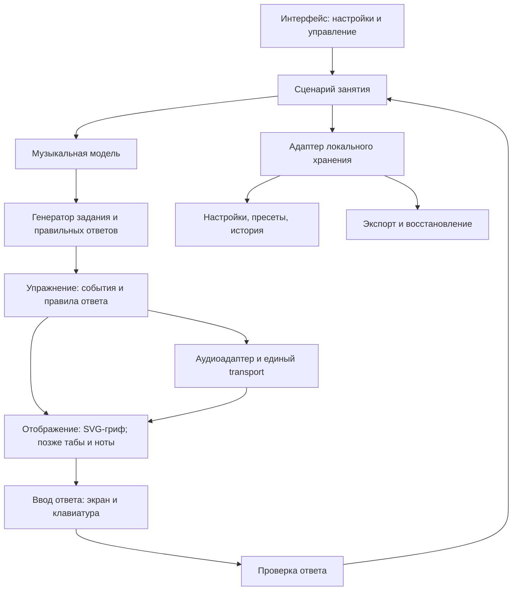

# Архитектура bass_study

Дата: 2026-11-08. Статус: **рабочая техническая основа принята по результатам P1; продукт ещё не реализован**.

Этот документ описывает принятое направление устройства будущего приложения и отдельно указывает проверенные части технического стенда. Цели находятся в [GOALS](GOALS.md), поведение и приёмка — в [REQUIREMENTS](REQUIREMENTS.md), порядок реализации — в [PLAN](PLAN.md), причины выбора — в [DECISIONS](DECISIONS.md). Основания исследования собраны в [RESEARCH](RESEARCH.md), фактические проверки — в [отчёте P1](verification/P1.md) и [машинном результате](verification/P1_EDGE_WINDOWS.json).

## 1. Архитектурные ориентиры

Подтверждённый сценарий — личные занятия на Windows-компьютере с клавиатурой, четырёхструнный бас E–A–D–G, приоритет грифа и основ. Соответствующие решения: D-001–D-003. Рабочий состав MVP закреплён в D-010, локальная техническая основа — в D-011, границы компонентов — в D-012. Исходные предложения D-007–D-009 сохранены как заменённые записи.

Выбрано статическое приложение без обязательного удалённого backend. Для стенда P1 закреплён адрес `http://localhost:4173`; сервер слушает loopback `127.0.0.1` и при занятом порте завершает запуск с ошибкой, не выбирая другой origin. При разработке приложения сохраняется стабильный адрес; изменение адреса требует явного переноса данных. Необходимые скрипты, шрифты и звуки поставляются вместе с приложением. GitHub хранит исходники и документацию, а не пользовательскую историю занятий.

Локальный HTTP-сервер раздаёт файлы и не становится сервером аккаунтов или облачного хранения. Сборка стенда P1 загружена в чистом профиле с отключённым кешем и блокировкой HTTP-запросов страниц стенда вне loopback; loopback оставался доступен. Сетевой адаптер Windows не отключался, фоновый сетевой трафик Windows не контролировался. Это подтверждает автономную загрузку проверенного стенда, но не заменяет будущую проверку полного занятия. PWA и service worker не нужны для выбранного способа локального запуска.

Открытие через `file://` не является обещанным способом запуска: модульные скрипты требуют корректной загрузки ресурсов; область хранения зависит от origin. `localhost`, `127.0.0.1` и разные порты нельзя считать одной базой пользовательских данных. Основания: [модули JavaScript](https://developer.mozilla.org/en-US/docs/Web/JavaScript/Guide/Modules), [IndexedDB](https://developer.mozilla.org/en-US/docs/Web/API/IndexedDB_API).

## 2. Компоненты и поток данных

Границы ниже приняты для реализации. В `experiments/p1` существуют только изолированные звуковая и IndexedDB-пробы и служебный интерфейс. Музыкальная модель, интерактивный гриф, учебные задания, история продукта и следующие представления ещё не созданы.

| Компонент | Ответственность | Граница |
|---|---|---|
| Музыкальная модель | Строй, высоты, позиции, гаммы, интервалы, написание нот | Чистые вычисления без DOM, аудиоконтекста и базы |
| Генератор | Выбор разрешимой цели, последовательности и множества ответов | Получает ограничения; не рисует и не запускает звук |
| Сценарий занятия | Режим, текущий шаг, повторы, темп, завершение и результат | Не содержит формул музыкальной теории или API IndexedDB |
| Проверка ответа | Сопоставление цели и пользовательского ответа | Не выводит качество игры из кликов или ручной отметки |
| Отображение | Гриф, подписи, состояния, доступное управление | Читает модель и позицию проигрывания; не задаёт аудиоритм |
| Аудиоадаптер | Запланированный звук, отсчёт, метроном, циклы, остановка | Не определяет правильные ноты задания |
| Хранение | Сохранение, чтение, миграции и резервная копия | Изолирует браузерную базу от учебной логики |

Типичный поток: настройки инструмента → допустимые позиции → цель и ответы → представление упражнения → ввод → проверка → результат занятия. Для проигрывания тот же материал преобразуется в музыкальные события. Режим изучения может работать без запуска звука.

## 3. Музыкальная модель

| Понятие | Представление для реализации | Зачем разделять |
|---|---|---|
| Класс ноты | Число 0–11, где C = 0 | Все A относятся к одному классу, но могут звучать в разных октавах |
| Абсолютная высота | MIDI-номер звучащей ноты | Определяет октаву и эталонную частоту |
| Написание | Буква, знак альтерации и отображаемая октава | F♯ и G♭ могут звучать одинаково, но означают разные интервальные функции |
| Ступень | Ступень и альтерация относительно заданного контекста | Зависит от тоники/аккорда, а не только от позиции |
| Позиция | Устойчивая ссылка на струну и целый лад | Одну абсолютную высоту можно сыграть в нескольких местах |
| Инструмент | Упорядоченные струны с открытыми высотами и доступным диапазоном ладов | Генератор не должен быть привязан к нарисованным координатам |

Для основного инструмента звучащие открытые струны снизу вверх: **E1–A1–D2–G2**, MIDI **28, 33, 38, 43**. Номер струны интерфейса не должен зависеть от индекса массива: первая струна — G, четвёртая — E. Формула позиции: `midi = openStringMidi + fret`; частота при A4 = 440 Гц: `440 × 2^((midi − 69) / 12)`.

Внутри используется звучащая высота. Будущая обычная басовая нотация получает отдельное октавное преобразование при отображении. Табы показывают реальные струну и лад. Изменение тембра не должно незаметно менять эталонную октаву. Учебные источники и независимые примеры приведены в [RESEARCH](RESEARCH.md).

Гамма задаётся музыкальным контекстом и интервалами, а её позиции вычисляются для выбранного инструмента и диапазона. Контекстное написание не сводится к единому массиву диезных названий. Например, поиск звучащей C♯/D♭ может иметь одинаковые позиции, а задание на ♯4 от C должно подписывать F♯, не G♭.

### Контрольные примеры для будущих проверок

- E/5 и A/0 имеют одну высоту A1, MIDI 33. При поиске A1 допустимы обе позиции, если обе разрешены фильтрами.
- E/0 и E/12 относятся к классу E, но имеют MIDI 28 и 40. В ответе на точную высоту они не взаимозаменяемы.
- Поиск «все E» на E/0–12 включает два ответа, а не один. Диапазон 0–11 содержит только нижнюю E.
- В гамме F major четвёртая ступень подписывается B♭; арифметическое совпадение с A♯ не заменяет контекстное написание.
- При струне E и ладах 0–3 генератор не выдаёт цель A: сначала строится множество доступных ответов.

## 4. Задания, ответы и музыкальные события

Концептуальные контракты ниже задают границы реализации, а не существующий публичный API или окончательный формат файла. Формат состояния технической пробы не становится автоматически форматом продукта.

| Операция | Вход | Выход |
|---|---|---|
| Построить доступные позиции | Инструмент, струны, границы ладов, музыкальные фильтры | Позиции с высотой, написанием и контекстной функцией |
| Создать задание | Доступные позиции, тип цели, сложность, порядок/seed | Формулировка, правило ответа, множество правильных ответов |
| Построить упражнение | Музыкальный материал, порядок, длительности | Упорядоченные события и границы повторяемого фрагмента |
| Проверить ответ | Задание, ответ, при необходимости время | Верность, объяснение и состояние завершения |
| Завершить занятие | Конфигурация, фактические ответы, ручные отметки | Раздельные измеренные и самостоятельно отмеченные результаты |

Правило ответа явно различает класс ноты, точную высоту, конкретную позицию и поиск всех позиций. Для последнего режима хранится множество найденных ответов; повторный клик не увеличивает результат. Недоступная или пустая комбинация фильтров объясняется до старта. Произвольная случайность должна быть воспроизводимой в тесте через фиксированную последовательность/seed.

Минимальное событие упражнения связывает устойчивый ID, высоту или паузу, начало и длительность в музыкальном времени, дорожку и при необходимости позицию. Начало и длительность не хранятся только в миллисекундах: изменение BPM должно сохранять ритмическую структуру. Представление длительностей должно точно выражать поддерживаемые подразделения; выбор ticks/рациональных долей фиксируется при реализации музыкального ядра.

В первой версии ответы поступают через экран и клавиатуру. Самооценка «сыграл уверенно при таком темпе» хранится отдельно от измеренной точности экранного задания. Будущий аудиовход подключается как самостоятельный источник наблюдений. По высоте звука нельзя достоверно установить выбранную струну, аппликатуру или качество глушения.

## 5. Проигрывание и синхронизация

Выбран один Tone.js transport на занятие за собственным адаптером. Метроном, эталонные ноты, отсчёт и подсветка используют одну музыкальную позицию. Аудиособытия планируются заранее относительно часов Web Audio; интерфейс обновляется по текущей позиции через кадры анимации. Обычный таймер UI не определяет каждый момент звука. Такой принцип описан в [руководстве MDN по sequencing](https://developer.mozilla.org/en-US/docs/Web/API/Web_Audio_API/Advanced_techniques) и [документации Tone.js по точному времени](https://github.com/Tonejs/Tone.js/wiki/Accurate-Timing). P1 проверяет transport и сигнал; продуктовая подсветка грифа появится на следующих этапах.

Семантика управления:

- **Старт:** после пользовательского действия активировать аудиоконтекст, подготовить инструмент и выполнить выбранный отсчёт. Отсчёт выполняется при новом старте, без повторения на границе цикла или при продолжении паузы.
- **Пауза/возобновление:** сохранить музыкальную позицию; не создавать вторую копию transport. Уже запланированный сигнал отключить; после явного продолжения создать активный голос и продолжить без нового отсчёта.
- **Стоп:** отменить будущие события, прекратить активные голоса и вернуть позицию к началу выбранного фрагмента. Завершённые результаты не стирать.
- **Цикл:** использовать полуоткрытый диапазон начала/конца; событие на границе следующего прохода звучит один раз. Повторы и рост BPM считаются по завершённым проходам.
- **Смена темпа:** сохранять музыкальную позицию; ручная команда ставится в очередь и применяется в следующем фактическом четвертном callback, ещё не отправленном в аудиодвижок. Последняя команда заменяет предыдущую до применения. Уже отправленная доля сохраняется; `requestedAt` и плановое время применения записываются раздельно. Лестница темпа на границах повторов остаётся будущей реализацией продукта.
- **Немые такты:** пропускать звук клика, сохраняя движение внутренней позиции. Возвращение клика не создаёт нового старта или отсчёта.

При скрытии вкладки занятие ставится на паузу и после возвращения ждёт явного продолжения. В P1 это проверено настоящим переключением вкладок в отдельном Edge-процессе через CDP с `noDefaults: true`; синтетическое событие не использовалось. Если браузер сам приостановил аудиоконтекст, экран не должен продолжать показывать якобы точную игру. Сон/возобновление Windows отдельно не проверены. Ограничения фоновых таймеров: [Page Visibility API](https://developer.mozilla.org/en-US/docs/Web/API/Page_Visibility_API).

По результатам P1 адаптер сохраняет запрос до следующего `onBeat(time)`, не выводя границу повторно через `nextSubdivision()` из зацикленного транспорта после паузы. Проверка подтверждает применение на реальном четвертном событии и новые интервалы. Числовые наблюдения и ограничения приведены в [отчёте P1](verification/P1.md); это не доказательство общего дефекта Tone.js или гарантии физической задержки.

Остановка в P1 отменяет события transport, отключает шину и освобождает активный голос: одной отмены callback недостаточно для уже отправленных Web Audio атак. Проверены нулевой live-сигнал после stop, отсутствие новых событий и три новых старта. Независимый трёхсекундный OfflineAudioContext-render содержит два отсчётных импульса, цикл, смену BPM и тишину после stop; фактические динамики и задержка аудиовыхода не измерялись.

Поддержка аудиоконтекста и задержка зависят от браузера и устройства; `latencyHint` — пожелание, а не гарантированная величина. Числовые обещания точности и автоматическая оценка игры появятся только после измерений. [MDN: AudioContext](https://developer.mozilla.org/en-US/docs/Web/API/AudioContext/AudioContext).

## 6. Хранение и восстановление

Выбран нативный IndexedDB за узким адаптером. Разделяются поставляемая библиотека упражнений, пользовательские настройки/пресеты и результаты занятий. Состояние проигрывателя в памяти не является источником сохранённой истории. Браузерная база асинхронна, поддерживает транзакции и привязана к origin. [MDN: IndexedDB](https://developer.mozilla.org/en-US/docs/Web/API/IndexedDB_API).

Резервная копия первой версии — переносимый JSON с версией формата, настройками, пользовательскими пресетами и историей. Звуковые файлы и встроенная библиотека в эту копию не входят; отдельный формат для пользовательского аудио потребуется при появлении соответствующего модуля. Моменты событий сохраняются в UTC вместе с часовым поясом занятия и локальной календарной датой; исторический день не пересчитывается при последующей смене пояса. По умолчанию используется пояс системы пользователя, локаль определяет только формат отображения.

Политика первой версии — полное восстановление пользовательского снимка, без объединения. Импорт сначала целиком проверяет формат, версию, содержимое и ссылки на встроенную библиотеку, затем показывает число восстанавливаемых пресетов и записей истории и сообщает о замене текущих пользовательских данных. До подтверждения доступен экспорт текущего состояния. Только после явного подтверждения снимок целиком заменяет настройки, пресеты и историю в одной транзакции. При любой ошибке действующая база остаётся прежней. Стенд поддерживает только `schemaVersion: 1`; неизвестная новая версия отклоняется. Миграций между версиями пока нет: они потребуются с появлением второй версии схемы. Стабильные ссылки на поставляемую библиотеку сохраняются; её содержимое в копию не дублируется.

Отказ сохранения и нехватка квоты должны быть видимы: нельзя сообщать об успешном сохранении после ошибки. При недоступной базе допускается занятие в памяти с явным сообщением, что история не сохраняется. Экспорт не заменяет сохранение; сохранение в браузере не заменяет резервную копию. Причины: [квоты и удаление браузерных данных](https://developer.mozilla.org/en-US/docs/Web/API/Storage_API/Storage_quotas_and_eviction_criteria).

В P1 пройдены запись/чтение/экспорт, отказ до записи для повреждённого JSON, новой версии, неверного темпа и висячей ссылки; отмена импорта и откат после принудительного abort уже после успешной первой записи; перезапуск браузера с тем же профилем; восстановление в чистом профиле и полная замена со снятием старых пресетов. Это результаты тестового набора, а не обещание безошибочного восстановления любых данных. Обновление схемы, реальная нехватка квоты и согласование нескольких вкладок остаются проверками будущего приложения.

## 7. Представления и управление

Для грифа выбран SVG с отдельными интерактивными элементами для позиций; сам гриф ещё не реализован. Подпись, тоника, активная нота и правильность ответа — независимые состояния. Поворот/масштаб отображения не меняет доменные координаты струны и лада. У активных элементов нужны понятные названия и видимый клавиатурный фокус; результат передаётся текстом, а не только цветом.

Горячие клавиши не должны перехватывать ввод чисел и текста в настройках. Основные действия доступны обычными кнопками. Режим изучения, экранная проверка и игра вместе с эталоном имеют различимые состояния, чтобы пользователь понимал, что именно измеряется.

Табы и нотный стан в дальнейшем получают те же музыкальные события. SVG-гриф и нотационная библиотека не конкурируют за одну задачу. Для нотации кандидат — [VexFlow](https://vexflow.com/); для расширенного импорта партитур возможен [alphaTab](https://github.com/CoderLine/alphaTab). До выбора второго проигрывателя нужно проверить взаимодействие с основным transport.

## 8. Принятая техническая основа

Версии закреплены в `experiments/p1/package-lock.json`; это зависимости технического стенда, а не готовая поставка тренажёра. Проверены Windows 11 Pro (10.0.26300), Edge **157.0.4341.42**, Node **24.18.0**, npm **11.16.0**. Chrome и другие браузеры не испытывались.

| Задача | Принятая основа и статус | Альтернатива и условие пересмотра |
|---|---|---|
| Язык и сборка | [TypeScript](https://www.typescriptlang.org/docs/) **7.0.2** + [Vite](https://vite.dev/guide/static-deploy.html) **8.3.6**; сборка стенда проходит | Изменение сборщика требует выявленной проблемы; JavaScript ослабит проверку музыкальных контрактов |
| Интерфейс и гриф | Семантический HTML, CSS, DOM и собственный SVG | UI-фреймворк выбирать при доказанной сложности состояния, а не ради первого грифа |
| Звук | Tone.js **15.1.22** через собственный адаптер; live-сигнал, transport и offline-PCM проверены | Прямой Web Audio остаётся альтернативой при выявленных ограничениях; сравнительный прототип второго движка не создавался |
| Локальная база | Нативный IndexedDB за адаптером | Маленькая оболочка допустима, если упрощает миграции и транзакции без изменения доменной модели |
| Будущая нотация | VexFlow после появления требования на полноценную запись | alphaTab рассматривать при необходимости импорта Guitar Pro/MusicXML и проверки его transport |
| Проверки | [Playwright](https://playwright.dev/docs/intro) **1.65.0** + Node assert: 13 браузерных проверок; [Vitest](https://vitest.dev/guide/) остаётся кандидатом для будущей музыкальной модели | Независимые музыкальные эталоны и ручное прослушивание потребуются при реализации продукта |

Tone.js выбран по достаточности проверенной пробы циклов и ручного темпа; адаптер ограничивает зависимость учебной логики от библиотеки. Официальный проект описывает transport и синтез поверх Web Audio: [Tone.js](https://github.com/Tonejs/Tone.js). Воспроизводимые команды, условия запуска и полный результат находятся в [отчёте P1](verification/P1.md). Сборка стенда не подтверждает готовность музыкальных упражнений или качество тембра на акустике пользователя.

## 9. Состояние технических рисков после P1

| Вопрос | Закрыто в P1 | Что остаётся |
|---|---|---|
| Браузер | Edge 157.0.4341.42 на указанной Windows; 13 проверок пройдены | Полные пользовательские сценарии и доступность; Chrome отдельно до объявления его поддержки |
| Способ запуска | Статическая сборка, localhost:4173, отказ при занятом порте, изоляция внешних запросов и сохранение после перезапуска браузера | Удобный пользовательский launcher, запуск после перезагрузки Windows и обновление поставки |
| Звуковая основа | Реальный сигнал в Analyser и offline-PCM; тишина после stop | Физические динамики, восприятие низких нот, аудиовыходная задержка и подбор громкостей |
| Работа transport | Отсчёт, цикл, пауза/продолжение, ручной BPM, остановка, три старта, реальное скрытие вкладки | Продуктовые немые такты, лестница BPM, синхронная подсветка грифа, sleep/resume ОС |
| Восстановление | Экспорт, чистый профиль, полная замена, отмена, четыре вида неверного импорта и abort после записи | Реальная квота, миграция будущей схемы и несколько вкладок |
| Нотация и распознавание | В рабочую основу не включены | Перед расширением — басовый эталон нотации и отдельное измерение аудиовхода/задержки |

Результаты P1 достаточны для начала музыкального ядра и грифа, но не закрывают приёмку первой версии. Оставшиеся проверки распределены в [PLAN](PLAN.md). Изменение принятой основы сопровождается новой записью единого [журнала решений](DECISIONS.md) и обновлением этого документа; исходные измерения сохраняются в отчёте проверки.
