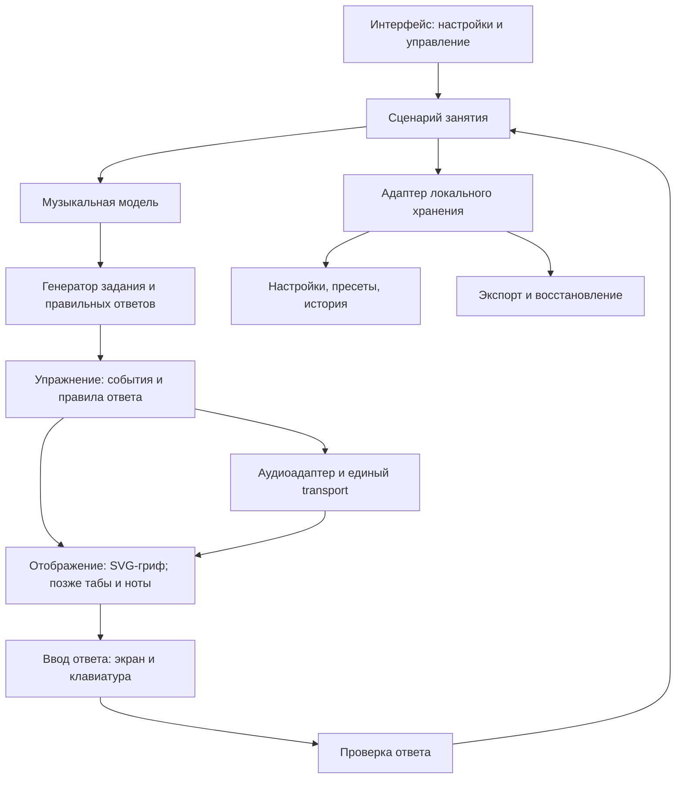

# Архитектура bass_study

Дата: 2026-11-08. Статус: **реализованы музыкальная модель, изучение грифа, экранные задания и звук/ритм P4; постоянные данные остаются P5**.

Этот документ описывает текущее устройство приложения и принятые границы последующих компонентов. Цели находятся в [GOALS](GOALS.md), поведение и приёмка — в [REQUIREMENTS](REQUIREMENTS.md), порядок реализации — в [PLAN](PLAN.md), причины выбора — в [DECISIONS](DECISIONS.md). Основания исследования собраны в [RESEARCH](RESEARCH.md); фактические проверки и их пределы — в отчётах [P1](verification/P1.md), [P2](verification/P2.md), [P3](verification/P3.md) и [P4](verification/P4.md).

## 1. Архитектурные ориентиры

Подтверждённый сценарий — личные занятия на Windows-компьютере с клавиатурой, четырёхструнный бас E–A–D–G, приоритет грифа и основ. Соответствующие решения: D-001–D-003. Рабочий состав MVP закреплён в D-010, техническая основа — в D-011/D-013, границы компонентов — в D-012, training-модуль — в D-015, продуктовый аудиоплан и transport — в D-016. Исходные предложения D-007–D-009 сохранены как заменённые записи. Порядок автономного продолжения задан D-014.

Выбрано статическое приложение без обязательного удалённого backend. Корневое приложение запускается на `http://localhost:4173`; сервер `scripts/serve.mjs` слушает loopback `127.0.0.1` и при занятом порте завершает запуск с ошибкой, не выбирая другой origin. Отдельный стенд P1 использует тот же адрес и запускается вместо приложения, а не одновременно. Смена адреса требует явного переноса будущих данных. Ресурсы приложения, включая синтез Tone.js, поставляются локально. GitHub хранит исходники и документацию, а не пользовательскую историю занятий.

Локальный HTTP-сервер раздаёт файлы и не становится сервером аккаунтов или облачного хранения. Сборка стенда P1 загружена в чистом профиле с отключённым кешем и блокировкой HTTP-запросов страниц стенда вне loopback; loopback оставался доступен. Сетевой адаптер Windows не отключался, фоновый сетевой трафик Windows не контролировался. Это подтверждает автономную загрузку проверенного стенда, но не заменяет будущую проверку полного занятия. PWA и service worker не нужны для выбранного способа локального запуска.

Открытие через `file://` не является обещанным способом запуска: модульные скрипты требуют корректной загрузки ресурсов; область хранения зависит от origin. `localhost`, `127.0.0.1` и разные порты нельзя считать одной базой пользовательских данных. Основания: [модули JavaScript](https://developer.mozilla.org/en-US/docs/Web/JavaScript/Guide/Modules), [IndexedDB](https://developer.mozilla.org/en-US/docs/Web/API/IndexedDB_API).

## 2. Компоненты и поток данных

Музыкальная модель реализована в `src/music/index.ts`, генерация/проверка заданий и последовательностей — в `src/training/index.ts`. `src/main.ts` владеет общими фильтрами и исследовательским грифом; `src/ui/training.ts` — экранной сессией, ответным грифом, сводкой и маршрутом; `src/ui/player.ts` — управлением практикой. Чистый `src/audio/plan.ts` задаёт музыкальную сетку, `src/audio/engine.ts` — Tone.js/Web Audio. Корневые package.json и lockfile относятся к приложению. `experiments/p1` остаётся отдельной исторической пробой; его IndexedDB не является продуктовым хранилищем.

В P4 маршрут последовательности связан с продуктовым transport и звучащей позицией. Постоянная история и резервная копия на схеме остаются будущими компонентами P5; их присутствие не означает готовый код.

| Компонент | Ответственность | Граница |
|---|---|---|
| Музыкальная модель | Строй, высоты, позиции, гаммы, интервалы, написание нот | Чистые вычисления без DOM, аудиоконтекста и базы |
| Генератор | Выбор разрешимой цели, последовательности и множества ответов | Получает ограничения; не рисует и не запускает звук |
| Сценарий занятия | Режим, текущий шаг, повторы, темп, завершение и результат | Не содержит формул музыкальной теории или API IndexedDB |
| Проверка ответа | Сопоставление цели и пользовательского ответа | Не выводит качество игры из кликов или ручной отметки |
| Отображение | Гриф, подписи, состояния, доступное управление | Читает модель и позицию проигрывания; не задаёт аудиоритм |
| Аудиоадаптер | Запланированный звук, отсчёт, метроном, циклы, остановка | Не определяет правильные ноты задания |
| Хранение | Сохранение, чтение, миграции и резервная копия | Изолирует браузерную базу от учебной логики |

Типичный поток: настройки инструмента → допустимые позиции → цель и ответы → представление упражнения → ввод → проверка → результат занятия. Для проигрывания тот же материал преобразуется в музыкальные события. Режим изучения может работать без запуска звука.

Изучение: настройки → музыкальный API → SVG и карточка связей. Задания: допустимые позиции и структура → `startQuiz` → ответ/показ/пропуск → новая сессия и обратная связь → сводка в памяти. Последовательности: тот же контекст → `createSequence` → видимый маршрут → аудиоплан → звук и текущая позиция → подсветка. Выбор в изучении не считается ответом в задании или измерением игры на басу.

## 3. Музыкальная модель

| Понятие | Представление для реализации | Зачем разделять |
|---|---|---|
| Класс ноты | Число 0–11, где C = 0 | Все A относятся к одному классу, но могут звучать в разных октавах |
| Абсолютная высота | MIDI-номер звучащей ноты | Определяет октаву и эталонную частоту |
| Написание | Буква, знак альтерации и отображаемая октава | F♯ и G♭ могут звучать одинаково, но означают разные интервальные функции |
| Ступень | Ступень и альтерация относительно заданного контекста | Зависит от тоники/аккорда, а не только от позиции |
| Позиция | Устойчивая ссылка на струну и целый лад | Одну абсолютную высоту можно сыграть в нескольких местах |
| Инструмент | Упорядоченные струны с открытыми высотами и доступным диапазоном ладов | Генератор не должен быть привязан к нарисованным координатам |

Для основного инструмента звучащие открытые струны снизу вверх: **E1–A1–D2–G2**, MIDI **28, 33, 38, 43**. Номер струны интерфейса не должен зависеть от индекса массива: первая струна — G, четвёртая — E. Формула позиции: `midi = openStringMidi + fret`; частота при A4 = 440 Гц: `440 × 2^((midi − 69) / 12)`.

Внутри используется звучащая высота. Будущая обычная басовая нотация получает отдельное октавное преобразование при отображении. Табы показывают реальные струну и лад. Изменение тембра не должно незаметно менять эталонную октаву. Учебные источники и независимые примеры приведены в [RESEARCH](RESEARCH.md).

Гамма задаётся музыкальным контекстом и интервалами, а её позиции вычисляются для выбранного инструмента и диапазона. Контекстное написание не сводится к единому массиву диезных названий. Например, поиск звучащей C♯/D♭ может иметь одинаковые позиции, а задание на ♯4 от C должно подписывать F♯, не G♭.

### Реализованный интерфейс музыкального модуля

`src/music/index.ts` не импортирует DOM, звук или хранилище. Экспортируемые определения и результаты неизменяемы; невалидная MIDI-высота, неизвестная струна или некорректный диапазон вызывают объяснимую ошибку. Пустой массив струн допустим и даёт пустое множество позиций.

| Экспорт | Фактический контракт P2 |
| --- | --- |
| `BASS_STRINGS`, `STRUCTURES` | Строй E/A/D/G и шесть структур с интервалами и ступенями относительно мажорной шкалы. |
| `parseNote(name)` | Буква, альтерация, класс и нормализованное имя; ASCII/Unicode знаки, включая двойные, без суффикса октавы. |
| `pitchClass(midi)`, `midiToFrequency(midi)` | MIDI 0–127 → класс 0–11 и эталонная частота при A4 = 440 Гц. |
| `formatMidi(midi, name?)` | Научная запись с октавой написания; MIDI 36 может быть C2 либо B♯1. Несовпадающее с высотой имя отклоняется. |
| `getPosition(string, fret)` | Позиция `{id,string,fret,midi,pitchClass,naturalName,frequency}`; ID вида `E:5`, лад 0–24. |
| `getPositions(filter)` | Включительный диапазон и выбранные струны → позиции в устойчивом порядке E/A/D/G. |
| `createStructure(root, id)` | Контекстные ноты, формула и функции для major/natural-minor, обеих пентатоник и двух трезвучий. |
| `annotatePositions(positions, structure)` | К позициям добавляются `inStructure`, `isRoot`, `noteName`, `degree`; исходные объекты не изменяются. |

Внутренние `degree` используют `b3`/`b7`, отображаемая формула — ♭3/♭7. Это функции относительно мажорной шкалы, не порядковые номера нот в пентатонике. Полный перечень контрольных значений и результаты проверок находятся в [отчёте P2](verification/P2.md).

### Инварианты музыкальной модели и последующих заданий

- E/5 и A/0 имеют одну высоту A1, MIDI 33. При поиске A1 допустимы обе позиции, если обе разрешены фильтрами.
- E/0 и E/12 относятся к классу E, но имеют MIDI 28 и 40. В ответе на точную высоту они не взаимозаменяемы.
- Поиск «все E» на E/0–12 включает два ответа, а не один. Диапазон 0–11 содержит только нижнюю E.
- В гамме F major четвёртая ступень подписывается B♭; арифметическое совпадение с A♯ не заменяет контекстное написание.
- При струне E и ладах 0–3 генератор не выдаёт цель A: сначала строится множество доступных ответов.

## 4. Задания, ответы и музыкальные события

`src/training/index.ts` не импортирует DOM, аудио или хранилище. Он получает аннотированные позиции и музыкальную структуру и возвращает неизменяемые вопросы, сессии, результаты и маршруты. Звуковые длительности и постоянный формат хранения ещё не реализованы; экспериментальный snapshot P1 не становится форматом продукта автоматически.

Реализованный API:

| Экспорт | Контракт P3 |
| --- | --- |
| `createQuestion(config)` | Режим, scope и seed → разрешимый вопрос, исходный контекст, правило ответа и варианты. Пустой материал отклоняется. |
| `startQuiz(config, count)` | Вопросы и начальная сессия со статусом `active`; UI использует 10 по умолчанию и 1–30 вопросов. |
| `submitAnswer(session, answer, elapsedMs)` | Проверяет ответ и монотонное время, возвращает новую сессию; терминальная сессия повторно не оценивается. |
| `revealAnswer`, `skipQuestion` | Завершают текущий вопрос с отдельным исходом, без самостоятельного правильного ответа. |
| `nextQuestion`, `getQuizSummary` | Архивирование результата и переход; сводка раздельно считает самостоятельные, исправления, ошибки, показы и пропуски. |
| `createSequence(config)` | Материал и порядок → неизменяемый массив позиций/высот; один маршрут для предпросмотра и проигрывания. |
| `createManualPracticeResult(input)` | Отдельная ручная модель из `src/training/results.ts`: self-report, комфортный BPM 40–220, длительность, заметка и снимок контекста; не содержит correct/accuracy. UI и сохранение этой отметки появятся на P5. |

Следующие концептуальные контракты показывают связь реализованного ядра с будущими музыкальными событиями:

| Операция | Вход | Выход |
|---|---|---|
| Построить доступные позиции | Инструмент, струны, границы ладов, музыкальные фильтры | Позиции с высотой, написанием и контекстной функцией |
| Создать задание | Доступные позиции, тип цели, сложность, порядок/seed | Формулировка, правило ответа, множество правильных ответов |
| Построить упражнение | Музыкальный материал, порядок, длительности | Упорядоченные события и границы повторяемого фрагмента |
| Проверить ответ | Задание, ответ, при необходимости время | Верность, объяснение и состояние завершения |
| Завершить занятие | Конфигурация, фактические ответы, ручные отметки | Раздельные измеренные и самостоятельно отмеченные результаты |

В текущих режимах имя проверяется как класс ноты, «найди» принимает любую подходящую позицию, «найди все» требует полное множество. Это не автоматически созданный отдельный режим точной октавы. Scope — выбранная структура или хроматика; поиск ступени допускает только структуру. Повтор найденной позиции не увеличивает попытки и результат. Генерация воспроизводима по seed; UI получает новый seed через `crypto.getRandomValues`, а тесты не подменяют генератор скрытыми правильными ответами.

Сессия проходит `active` → `review` → следующий вопрос/`finished`. Контекст фиксируется при создании. Первый ответ/время, исправления, события и исход хранятся отдельно; после ошибки правильный ответ не становится самостоятельным задним числом. «Найди все» считается самостоятельным только при полном наборе без ошибок и показа ответа. Сводка сохраняет исходный материал и относится к экранным действиям, а не исполнению на инструменте. `TrainingResult` различает `QuizResult` и `ManualPracticeResult`; ручная модель не попадает в точность экранного квиза.

Смена общей конфигурации или режима завершает активную серию; возврат требует нового старта. Невалидный диапазон передаёт пустой контекст заданиям, даже если исследовательский гриф ещё показывает последнюю корректную область. До ответа/показа карта, названия структуры и имена/MIDI в ARIA ответного грифа не раскрывают решение.

Маршрут сортируется по уникальным MIDI, затем при совпадениях выбирает E/A/D/G и минимальный лад. Для `round-trip` четыре высоты дают `[1,2,3,4,3,2]`; повтор начинается с 1 без дублирования краёв. Группы по три перекрываются. Предпросмотр не запускает звук и не обещает оптимальную аппликатуру.

Событие аудиоплана связывает номер шестнадцатой сетки, фазу, проход, долю/такт, индекс и позицию ноты, BPM и признак клика. Начало и длительность не хранятся только в миллисекундах: transport переводит музыкальную сетку в аудиовремя, сохраняя структуру при смене BPM.

В первой версии ответы поступают через экран и клавиатуру. Самооценка «сыграл уверенно при таком темпе» хранится отдельно от измеренной точности экранного задания. Будущий аудиовход подключается как самостоятельный источник наблюдений. По высоте звука нельзя достоверно установить выбранную струну, аппликатуру или качество глушения.

## 5. Проигрывание и синхронизация

Реализованы чистый план `src/audio/plan.ts`, адаптер `src/audio/engine.ts` и контроллер `src/ui/player.ts`. План использует сетку шестнадцатых: четверть = 4 деления, восьмая = 2, шестнадцатая = 1. Один Tone.js transport контекста обслуживает ноты, отсчёт, метроном и границы проходов; внутри Tone native loop не включён, проходы определяет план. Одновременно UI владеет одним плеером.

Аудиособытия отправляются заранее относительно часов Web Audio. `getSnapshot()` выбирает последний кадр, время которого уже наступило; будущий callback не двигает видимую позицию. UI через `requestAnimationFrame` читает снимок и подсвечивает SVG и карточку маршрута по тем же ID/индексу. Таймер UI не задаёт момент звука. Основания принципа: [MDN sequencing](https://developer.mozilla.org/en-US/docs/Web/API/Web_Audio_API/Advanced_techniques), [Tone.js Accurate Timing](https://github.com/Tonejs/Tone.js/wiki/Accurate-Timing). Продуктовые проверки и границы доказательства находятся в [P4](verification/P4.md).

`createPlayer()` возвращает `start`, `pause`, `resume`, `stop`, `setBpm`, `setVolumes`, `getSnapshot`, `renderOffline` и `dispose`. Конфигурация получает существующие `AnnotatedPosition[]`, диапазон, длительность, BPM, отсчёт, повтор и метроном. Два синтезатора и независимые gain-шины баса/клика сходятся в общую шину с реальным анализатором. В offline-render шины разведены по двум PCM-каналам для независимой проверки; это проверочный API движка, не пользовательский экспорт аудио.

Семантика управления:

- **Старт:** после пользовательского действия активировать аудиоконтекст, подготовить инструмент и выполнить выбранный отсчёт. Отсчёт выполняется при новом старте, без повторения на границе цикла или при продолжении паузы.
- **Пауза/возобновление:** сохранить фактические ticks, отключить запланированный сигнал, отменить будущие кадры и продолжить без повторного отсчёта. Дробный offset передаётся через `Tone.TicksClass`: строка с дробными ticks в проверенной версии могла интерпретироваться как секунды. Отдельно проверена непрерывность сетки и маршрута, включая паузу до будущего старта.
- **Стоп:** отменить будущие callback, обнулить общую шину и освободить синтезаторы; сбросить позицию. Новый старт начинает выбранный фрагмент и выбранный отсчёт заново. В trace отменённые lookahead-события помечаются `cancelled`, а не выдаются за прозвучавшие.
- **Цикл:** внутренний полуоткрытый диапазон `[from,toExclusive)` соответствует включительным номерам первой/последней ноты UI. Один проход, бесконечный повтор и конечная лестница используют одну сетку без дубля границы.
- **Смена темпа:** ручная команда применяется на следующей ещё не отправленной четверти, последняя команда заменяет предыдущую до применения. `requestedAt` и аудиовремя применения различаются. В паузе BPM действует при продолжении; лестница меняет BPM на границе прохода и блокирует ручной темп до стопа.
- **Немые такты:** пропускать звук клика, сохраняя движение внутренней позиции. Возвращение клика не создаёт нового старта или отсчёта.
- **Конец:** запланированный конец переводит движок в `finishing`; голоса и позиция завершаются только при достижении аудиочасами `finishAt`. Раннее планирование не обрывает последний проход.

Контроллер при настоящем скрытии вкладки вызывает `pause('hidden')`; возврат оставляет плеер на паузе до явного продолжения. P4 повторно проверил это в отдельном Edge через CDP с `noDefaults: true` и фактическим переключением вкладок, без синтетического события. Сон Windows, смена устройства и произвольное внешнее приостановление аудиоконтекста отдельно не испытаны. Ограничения фоновых таймеров: [Page Visibility API](https://developer.mozilla.org/en-US/docs/Web/API/Page_Visibility_API).

Структурные настройки плеера фиксируются до стопа; ручной BPM обычного повтора и громкости доступны во время игры. Смена общей области/маршрута и выход из последовательностей останавливают плеер. Отключение визуального пульса убирает счёт, текущую ноту и обе подсветки. Space/Escape работают только вне интерактивных элементов.

Тестовый `window.p4` существует только в изолированной fixture, импортирующей фактический движок через Vite; в продуктовом UI глобального тестового API нет. Независимые ожидания PCM, реальные live-уровни, будущие/наступившие события, сетка после паузы и пользовательские действия проверяются раздельно. Числовые результаты и исправления принадлежат [отчёту P4](verification/P4.md), а не этому описанию устройства.

Поддержка аудиоконтекста и задержка зависят от браузера и устройства; `latencyHint` — пожелание, а не гарантированная величина. Числовые обещания точности и автоматическая оценка игры появятся только после измерений. [MDN: AudioContext](https://developer.mozilla.org/en-US/docs/Web/API/AudioContext/AudioContext).

## 6. Хранение и восстановление

Выбран нативный IndexedDB за узким адаптером. Разделяются поставляемая библиотека упражнений, пользовательские настройки/пресеты и результаты занятий. Состояние проигрывателя в памяти не является источником сохранённой истории. Браузерная база асинхронна, поддерживает транзакции и привязана к origin. [MDN: IndexedDB](https://developer.mozilla.org/en-US/docs/Web/API/IndexedDB_API).

Резервная копия первой версии — переносимый JSON с версией формата, настройками, пользовательскими пресетами и историей. Звуковые файлы и встроенная библиотека в эту копию не входят; отдельный формат для пользовательского аудио потребуется при появлении соответствующего модуля. Моменты событий сохраняются в UTC вместе с часовым поясом занятия и локальной календарной датой; исторический день не пересчитывается при последующей смене пояса. По умолчанию используется пояс системы пользователя, локаль определяет только формат отображения.

Политика первой версии — полное восстановление пользовательского снимка, без объединения. Импорт сначала целиком проверяет формат, версию, содержимое и ссылки на встроенную библиотеку, затем показывает число восстанавливаемых пресетов и записей истории и сообщает о замене текущих пользовательских данных. До подтверждения доступен экспорт текущего состояния. Только после явного подтверждения снимок целиком заменяет настройки, пресеты и историю в одной транзакции. При любой ошибке действующая база остаётся прежней. Стенд поддерживает только `schemaVersion: 1`; неизвестная новая версия отклоняется. Миграций между версиями пока нет: они потребуются с появлением второй версии схемы. Стабильные ссылки на поставляемую библиотеку сохраняются; её содержимое в копию не дублируется.

Отказ сохранения и нехватка квоты должны быть видимы: нельзя сообщать об успешном сохранении после ошибки. При недоступной базе допускается занятие в памяти с явным сообщением, что история не сохраняется. Экспорт не заменяет сохранение; сохранение в браузере не заменяет резервную копию. Причины: [квоты и удаление браузерных данных](https://developer.mozilla.org/en-US/docs/Web/API/Storage_API/Storage_quotas_and_eviction_criteria).

В P1 пройдены запись/чтение/экспорт, отказ до записи для повреждённого JSON, новой версии, неверного темпа и висячей ссылки; отмена импорта и откат после принудительного abort уже после успешной первой записи; перезапуск браузера с тем же профилем; восстановление в чистом профиле и полная замена со снятием старых пресетов. Это результаты тестового набора, а не обещание безошибочного восстановления любых данных. Обновление схемы, реальная нехватка квоты и согласование нескольких вкладок остаются проверками будущего приложения.

## 7. Представления и управление

Гриф реализован в SVG: G/D/A/E сверху вниз, отдельный доступный элемент `role=button` для каждой позиции, открытые струны и включительный диапазон. При 0–24 гриф прокручивается внутри своей области, не расширяя всю страницу. Фокус и выбранная позиция различаются: стрелки/Home/End перемещают фокус, Enter/пробел выбирают. В Tab-порядке остаётся одна позиция грифа. Струны, диапазон, тоника, структура и режим подписей управляются нативными контролами.

Тоника, выбранная позиция и совпадение по высоте имеют разные обводки и доступные подписи. Карточка показывает научную высоту, струну/лад, MIDI, частоту и принадлежность структуре; соседняя область различает ту же высоту и другие октавы. Пустой фильтр объясняется, неверный диапазон оставляет последний корректный исследовательский гриф и видимую ошибку, но блокирует новые задания.

Режимы «Изучение», «Задания», «Последовательности» разделяют сценарии. У квиза отдельный ответный SVG без названий нот до показа, клавиатурная навигация и переход фокуса к следующему вопросу после завершения. Ошибка, частичное нахождение, исправление, показ и пропуск видны текстом. В последовательностях есть предпросмотр и плеер; постоянной истории и ручной формы результата в UI пока нет.

Горячие клавиши не должны перехватывать ввод чисел и текста в настройках. Основные действия доступны обычными кнопками. Режим изучения, экранная проверка и игра вместе с эталоном имеют различимые состояния, чтобы пользователь понимал, что именно измеряется.

Табы и нотный стан в дальнейшем получают те же музыкальные события. SVG-гриф и нотационная библиотека не конкурируют за одну задачу. Для нотации кандидат — [VexFlow](https://vexflow.com/); для расширенного импорта партитур возможен [alphaTab](https://github.com/CoderLine/alphaTab). До выбора второго проигрывателя нужно проверить взаимодействие с основным transport.

## 8. Принятая техническая основа

Версии приложения закреплены корневым `package-lock.json`: TypeScript **7.0.2**, Vite **8.3.6**, Vitest **5.1.0**, Playwright **1.65.0**. Tone.js **15.1.22** добавлен в корневые зависимости как подготовка P4, но ещё не импортирован учебным UI и не означает готовый плеер. У P1 собственный lockfile. Проверены Windows 11 Pro (10.0.26300), Edge **157.0.4341.42**, Node **24.18.0**, npm **11.16.0**. Chrome и другие браузеры не испытывались.

| Задача | Принятая основа и статус | Альтернатива и условие пересмотра |
|---|---|---|
| Язык и сборка | [TypeScript](https://www.typescriptlang.org/docs/) **7.0.2** + [Vite](https://vite.dev/guide/static-deploy.html) **8.3.6**; корневое приложение собирается | Изменение сборщика требует выявленной проблемы; JavaScript ослабит проверку музыкальных контрактов |
| Интерфейс и гриф | Реализованы семантический HTML, CSS, DOM и SVG | UI-фреймворк выбирать при доказанной сложности состояния |
| Звук | Tone.js **15.1.22** через собственный адаптер; live-сигнал, transport и offline-PCM проверены | Прямой Web Audio остаётся альтернативой при выявленных ограничениях; сравнительный прототип второго движка не создавался |
| Локальная база | Нативный IndexedDB за адаптером | Маленькая оболочка допустима, если упрощает миграции и транзакции без изменения доменной модели |
| Будущая нотация | VexFlow после появления требования на полноценную запись | alphaTab рассматривать при необходимости импорта Guitar Pro/MusicXML и проверки его transport |
| Проверки | [Vitest](https://vitest.dev/guide/) **5.1.0** — музыка, training и чистый аудиоплан; [Playwright](https://playwright.dev/docs/intro) **1.65.0** + Node assert — интерфейсы и Web Audio | Состав и числа P1–P4 находятся в отчётах; полный цикл с постоянными данными остаётся P5/P6 |

Tone.js выбран по достаточности проверенной пробы циклов и ручного темпа; адаптер ограничивает зависимость учебной логики от библиотеки. Официальный проект описывает transport и синтез поверх Web Audio: [Tone.js](https://github.com/Tonejs/Tone.js). Воспроизводимые команды, условия запуска и полный результат находятся в [отчёте P1](verification/P1.md). Сборка стенда не подтверждает готовность музыкальных упражнений или качество тембра на акустике пользователя.

## 9. Состояние технических рисков после P4

| Вопрос | Что проверено | Что остаётся |
|---|---|---|
| Браузер | Edge 157.0.4341.42: пробы P1 и продуктовые P2–P4 пройдены | Полный учебный цикл; Chrome отдельно до объявления его поддержки |
| Музыкальная модель и гриф | Чистые расчёты, написание, фильтры, выбор/клавиатура и подсветка текущей звучащей позиции | Расширенные режимы точной высоты R-004 и полная приёмка |
| Задания и последовательности | Разрешимые вопросы, независимые исходы, отмена при изменениях, чистые маршруты и плеер | Постоянная история и адаптация |
| Способ запуска | Статическая сборка, localhost:4173, отказ при занятом порте, изоляция внешних запросов и сохранение после перезапуска браузера | Удобный пользовательский launcher, запуск после перезагрузки Windows и обновление поставки |
| Звуковая основа | Реальный сигнал в Analyser и offline-PCM; тишина после stop | Физические динамики, восприятие низких нот, аудиовыходная задержка и подбор громкостей |
| Работа transport | Продуктовые отсчёт, цикл/фрагмент, дробная пауза, ручной BPM/лестница, немые такты, подсветка, стоп/перезапуски и реальное скрытие вкладки | Длительное занятие, sleep/resume ОС и смена аудиоустройства |
| Восстановление | Экспорт, чистый профиль, полная замена, отмена, четыре вида неверного импорта и abort после записи | Реальная квота, миграция будущей схемы и несколько вкладок |
| Нотация и распознавание | В рабочую основу не включены | Перед расширением — басовый эталон нотации и отдельное измерение аудиовхода/задержки |

P4 добавил звук и ритм поверх того же маршрута, сохранив регрессии изучения и заданий. Это не закрывает приёмку первой версии: следующий P5 добавляет постоянные данные, P6 проверяет весь выбранный объём. Числа и состав проверок принадлежат [отчёту P4](verification/P4.md), оставшиеся работы — [плану](PLAN.md). Изменение принятой основы сопровождается новой записью единого [журнала решений](DECISIONS.md).
