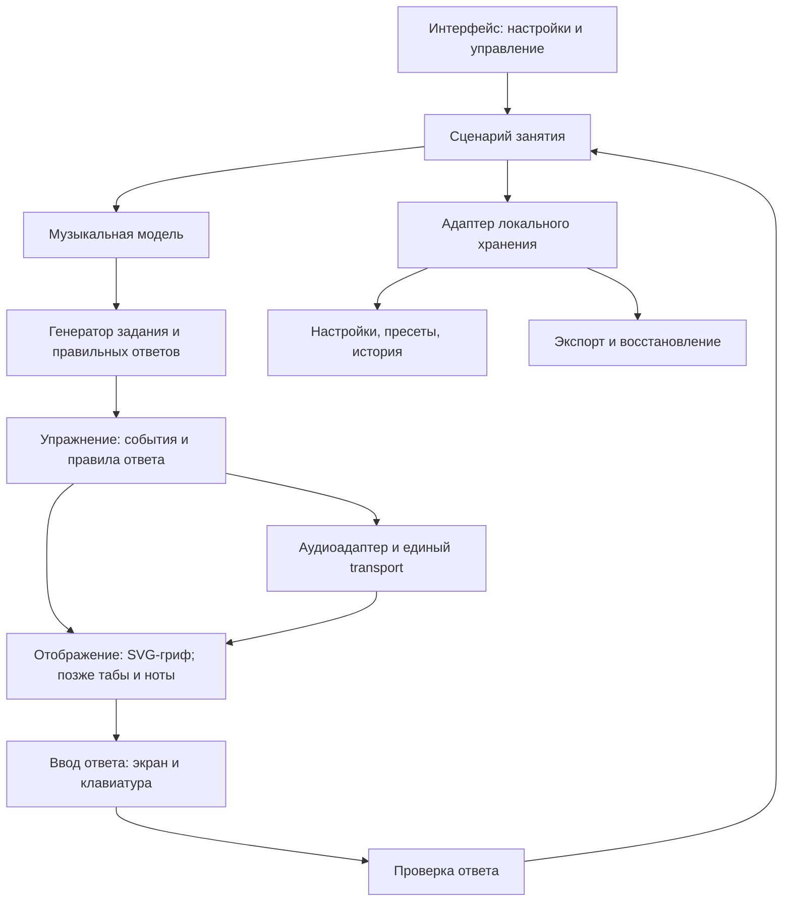

# Предлагаемая архитектура bass_study

Дата: 2026-11-08. Статус: **предложение; приложение и прототипы ещё не созданы**.

Этот документ описывает устройство будущего приложения. Цели находятся в [GOALS](GOALS.md), поведение и приёмка — в [REQUIREMENTS](REQUIREMENTS.md), порядок реализации — в [PLAN](PLAN.md), причины выбора — в [DECISIONS](DECISIONS.md). Здесь нет утверждения, что предложенные компоненты уже работают. Основания и ограничения исследования собраны в [RESEARCH](RESEARCH.md).

## 1. Архитектурные ориентиры

Подтверждённый сценарий — личные занятия на Windows-компьютере с клавиатурой, четырёхструнный бас E–A–D–G, приоритет грифа и основ. Соответствующие принятые решения: D-001–D-003. Локальное веб-приложение и разделение компонентов предлагаются в D-007 и D-008; состав MVP — в D-009.

Предлагается статическое приложение без обязательного удалённого backend. Оно запускается с постоянного `http://localhost:<порт>`; порт и способ запуска следует выбрать и проверить на этапе подготовки приложения. Все необходимые скрипты, шрифты и звуки входят в поставку. GitHub хранит исходники и документацию, а не пользовательскую историю занятий.

Локальный HTTP-сервер раздаёт файлы и не становится сервером аккаунтов или облачного хранения. Базовое занятие должно работать без сети после подготовки приложения. Пока это проектное требование, а не результат офлайн-испытания. PWA и service worker можно добавить отдельным слоем после проверки обычного локального запуска.

Открытие через `file://` не является обещанным способом запуска: модульные скрипты требуют корректной загрузки ресурсов; область хранения зависит от origin. `localhost`, `127.0.0.1` и разные порты нельзя считать одной базой пользовательских данных. Основания: [модули JavaScript](https://developer.mozilla.org/en-US/docs/Web/JavaScript/Guide/Modules), [IndexedDB](https://developer.mozilla.org/en-US/docs/Web/API/IndexedDB_API).

## 2. Компоненты и поток данных

| Компонент | Ответственность | Граница |
|---|---|---|
| Музыкальная модель | Строй, высоты, позиции, гаммы, интервалы, написание нот | Чистые вычисления без DOM, аудиоконтекста и базы |
| Генератор | Выбор разрешимой цели, последовательности и множества ответов | Получает ограничения; не рисует и не запускает звук |
| Сценарий занятия | Режим, текущий шаг, повторы, темп, завершение и результат | Не содержит формул музыкальной теории или API IndexedDB |
| Проверка ответа | Сопоставление цели и пользовательского ответа | Не выводит качество игры из кликов или ручной отметки |
| Отображение | Гриф, подписи, состояния, доступное управление | Читает модель и позицию проигрывания; не задаёт аудиоритм |
| Аудиоадаптер | Запланированный звук, отсчёт, метроном, циклы, остановка | Не определяет правильные ноты задания |
| Хранение | Сохранение, чтение, миграции и резервная копия | Изолирует браузерную базу от учебной логики |

Типичный поток: настройки инструмента → допустимые позиции → цель и ответы → представление упражнения → ввод → проверка → результат занятия. Для проигрывания тот же материал преобразуется в музыкальные события. Режим изучения может работать без запуска звука.

## 3. Музыкальная модель

| Понятие | Предлагаемое представление | Зачем разделять |
|---|---|---|
| Класс ноты | Число 0–11, где C = 0 | Все A относятся к одному классу, но могут звучать в разных октавах |
| Абсолютная высота | MIDI-номер звучащей ноты | Определяет октаву и эталонную частоту |
| Написание | Буква, знак альтерации и отображаемая октава | F♯ и G♭ могут звучать одинаково, но означают разные интервальные функции |
| Ступень | Ступень и альтерация относительно заданного контекста | Зависит от тоники/аккорда, а не только от позиции |
| Позиция | Устойчивая ссылка на струну и целый лад | Одну абсолютную высоту можно сыграть в нескольких местах |
| Инструмент | Упорядоченные струны с открытыми высотами и доступным диапазоном ладов | Генератор не должен быть привязан к нарисованным координатам |

Для основного инструмента звучащие открытые струны снизу вверх: **E1–A1–D2–G2**, MIDI **28, 33, 38, 43**. Номер струны интерфейса не должен зависеть от индекса массива: первая струна — G, четвёртая — E. Формула позиции: `midi = openStringMidi + fret`; частота при A4 = 440 Гц: `440 × 2^((midi − 69) / 12)`.

Внутри используется звучащая высота. Будущая обычная басовая нотация получает отдельное октавное преобразование при отображении. Табы показывают реальные струну и лад. Изменение тембра не должно незаметно менять эталонную октаву. Учебные источники и независимые примеры приведены в [RESEARCH](RESEARCH.md).

Гамма задаётся музыкальным контекстом и интервалами, а её позиции вычисляются для выбранного инструмента и диапазона. Контекстное написание не сводится к единому массиву диезных названий. Например, поиск звучащей C♯/D♭ может иметь одинаковые позиции, а задание на ♯4 от C должно подписывать F♯, не G♭.

### Контрольные примеры для будущих проверок

- E/5 и A/0 имеют одну высоту A1, MIDI 33. При поиске A1 допустимы обе позиции, если обе разрешены фильтрами.
- E/0 и E/12 относятся к классу E, но имеют MIDI 28 и 40. В ответе на точную высоту они не взаимозаменяемы.
- Поиск «все E» на E/0–12 включает два ответа, а не один. Диапазон 0–11 содержит только нижнюю E.
- В гамме F major четвёртая ступень подписывается B♭; арифметическое совпадение с A♯ не заменяет контекстное написание.
- При струне E и ладах 0–3 генератор не выдаёт цель A: сначала строится множество доступных ответов.

## 4. Задания, ответы и музыкальные события

Концептуальные контракты ниже — ориентир для реализации, а не существующий публичный API или окончательный формат файла.

| Операция | Вход | Выход |
|---|---|---|
| Построить доступные позиции | Инструмент, струны, границы ладов, музыкальные фильтры | Позиции с высотой, написанием и контекстной функцией |
| Создать задание | Доступные позиции, тип цели, сложность, порядок/seed | Формулировка, правило ответа, множество правильных ответов |
| Построить упражнение | Музыкальный материал, порядок, длительности | Упорядоченные события и границы повторяемого фрагмента |
| Проверить ответ | Задание, ответ, при необходимости время | Верность, объяснение и состояние завершения |
| Завершить занятие | Конфигурация, фактические ответы, ручные отметки | Раздельные измеренные и самостоятельно отмеченные результаты |

Правило ответа явно различает класс ноты, точную высоту, конкретную позицию и поиск всех позиций. Для последнего режима хранится множество найденных ответов; повторный клик не увеличивает результат. Недоступная или пустая комбинация фильтров объясняется до старта. Произвольная случайность должна быть воспроизводимой в тесте через фиксированную последовательность/seed.

Минимальное событие упражнения связывает устойчивый ID, высоту или паузу, начало и длительность в музыкальном времени, дорожку и при необходимости позицию. Начало и длительность не хранятся только в миллисекундах: изменение BPM должно сохранять ритмическую структуру. Представление длительностей должно точно выражать поддерживаемые подразделения; выбор ticks/рациональных долей фиксируется при реализации музыкального ядра.

В первой версии ответы поступают через экран и клавиатуру. Самооценка «сыграл уверенно при таком темпе» хранится отдельно от измеренной точности экранного задания. Будущий аудиовход подключается как самостоятельный источник наблюдений. По высоте звука нельзя достоверно установить выбранную струну, аппликатуру или качество глушения.

## 5. Проигрывание и синхронизация

Предлагается один transport на всё занятие. Метроном, эталонные ноты, отсчёт и подсветка используют одну музыкальную позицию. Аудиособытия планируются заранее относительно часов Web Audio; интерфейс обновляется по текущей позиции через кадры анимации. Обычный таймер UI не должен непосредственно определять каждый момент звука. Такой принцип описан в [руководстве MDN по sequencing](https://developer.mozilla.org/en-US/docs/Web/API/Web_Audio_API/Advanced_techniques) и [документации Tone.js по точному времени](https://github.com/Tonejs/Tone.js/wiki/Accurate-Timing).

Предлагаемая семантика управления:

- **Старт:** после пользовательского действия активировать аудиоконтекст, подготовить инструмент и выполнить выбранный отсчёт. Пока ресурсы не готовы, не запускать «немое» занятие как успешно начатое.
- **Пауза/возобновление:** сохранить музыкальную позицию; не создавать вторую копию transport. Отсчёт при возобновлении задаётся сценарием занятия.
- **Стоп:** отменить будущие события, прекратить активные голоса и вернуть позицию к началу выбранного фрагмента. Завершённые результаты не стирать.
- **Цикл:** использовать полуоткрытый диапазон начала/конца; событие на границе следующего прохода звучит один раз. Повторы и рост BPM считаются по завершённым проходам.
- **Смена темпа:** сохранять музыкальную позицию; лестница темпа применяется на границе повторов. При ручной смене необходимо перепланировать ещё не сыгранные события без дубликатов.
- **Немые такты:** пропускать звук клика, сохраняя движение внутренней позиции. Возвращение клика не создаёт нового старта или отсчёта.

При скрытии вкладки предлагается ставить занятие на паузу и после возвращения явно предлагать продолжение. Если браузер сам приостановил аудиоконтекст, экран не должен продолжать показывать якобы точную игру. Стабильную фоновую работу не обещаем до отдельной проверки. Ограничения таймеров и отрисовки: [Page Visibility API](https://developer.mozilla.org/en-US/docs/Web/API/Page_Visibility_API).

Поддержка аудиоконтекста и задержка зависят от браузера и устройства; `latencyHint` — пожелание, а не гарантированная величина. Числовые обещания точности и автоматическая оценка игры появятся только после измерений. [MDN: AudioContext](https://developer.mozilla.org/en-US/docs/Web/API/AudioContext/AudioContext).

## 6. Хранение и восстановление

Предлагается IndexedDB за узким адаптером. Разделяются поставляемая библиотека упражнений, пользовательские настройки/пресеты и результаты занятий. Состояние проигрывателя в памяти не является источником сохранённой истории. Браузерная база асинхронна, поддерживает транзакции и привязана к origin. [MDN: IndexedDB](https://developer.mozilla.org/en-US/docs/Web/API/IndexedDB_API).

Резервная копия первой версии — переносимый JSON с версией формата, настройками, пользовательскими пресетами и историей. Звуковые файлы и встроенная библиотека в эту копию не входят; отдельный формат для пользовательского аудио потребуется при появлении соответствующего модуля. Моменты событий сохраняются в UTC вместе с часовым поясом занятия и локальной календарной датой; исторический день не пересчитывается при последующей смене пояса. По умолчанию используется пояс системы пользователя, локаль определяет только формат отображения.

Предлагаемая политика первой версии — полное восстановление пользовательского снимка, без объединения. Импорт сначала целиком проверяет формат, версию, содержимое и ссылки на встроенную библиотеку, затем показывает число восстанавливаемых пресетов и записей истории и сообщает о замене текущих пользовательских данных. До подтверждения доступен экспорт текущего состояния. Только после явного подтверждения снимок целиком заменяет настройки, пресеты и историю в одной транзакции. При любой ошибке действующая база остаётся прежней. Неизвестная новая версия отклоняется с объяснением; предыдущая поддерживаемая версия проходит явную миграцию. Стабильные ссылки на поставляемую библиотеку сохраняются; её содержимое в копию не дублируется.

Отказ сохранения и нехватка квоты должны быть видимы: нельзя сообщать об успешном сохранении после ошибки. При недоступной базе допускается занятие в памяти с явным сообщением, что история не сохраняется. Экспорт не заменяет сохранение; сохранение в браузере не заменяет резервную копию. Причины: [квоты и удаление браузерных данных](https://developer.mozilla.org/en-US/docs/Web/API/Storage_API/Storage_quotas_and_eviction_criteria).

Обязательный будущий сценарий проверки: экспорт → новый профиль/чистая база → импорт → сравнение настроек, пресетов и результатов. Обновление версии приложения проверяется отдельно от очистки данных. Одновременный запуск нескольких вкладок до отдельной поддержки должен предотвращать конфликтующие записи или явно ограничивать занятие одной активной вкладкой.

## 7. Представления и управление

Гриф предлагается рисовать в SVG с отдельными интерактивными элементами для позиций. Подпись, тоника, активная нота и правильность ответа — независимые состояния. Поворот/масштаб отображения не меняет доменные координаты струны и лада. У активных элементов нужны понятные названия и видимый клавиатурный фокус; результат передаётся текстом, а не только цветом.

Горячие клавиши не должны перехватывать ввод чисел и текста в настройках. Основные действия доступны обычными кнопками. Режим изучения, экранная проверка и игра вместе с эталоном имеют различимые состояния, чтобы пользователь понимал, что именно измеряется.

Табы и нотный стан в дальнейшем получают те же музыкальные события. SVG-гриф и нотационная библиотека не конкурируют за одну задачу. Для нотации кандидат — [VexFlow](https://vexflow.com/); для расширенного импорта партитур возможен [alphaTab](https://github.com/CoderLine/alphaTab). До выбора второго проигрывателя нужно проверить взаимодействие с основным transport.

## 8. Рекомендация по технологиям

Весь набор ниже **предлагается**, зависимости ещё не установлены и совместимость в проекте не проверена.

| Задача | Рекомендуемый кандидат | Альтернатива и условие пересмотра |
|---|---|---|
| Язык и сборка | [TypeScript](https://www.typescriptlang.org/docs/) + [Vite](https://vite.dev/guide/static-deploy.html); статическая production-сборка | JavaScript уменьшает настройку, но ослабляет проверку контрактов музыкальной модели |
| Интерфейс и гриф | Семантический HTML, CSS, DOM и собственный SVG | UI-фреймворк выбирать при доказанной сложности состояния, а не ради первого грифа |
| Звук | Tone.js через собственный аудиоадаптер | Чистый Web Audio подходит при меньшем объёме transport; потребует собственного scheduler и управления голосами |
| Локальная база | Нативный IndexedDB за адаптером | Маленькая оболочка допустима, если упрощает миграции и транзакции без изменения доменной модели |
| Будущая нотация | VexFlow после появления требования на полноценную запись | alphaTab рассматривать при необходимости импорта Guitar Pro/MusicXML и проверки его transport |
| Проверки после появления кода | [Vitest](https://vitest.dev/guide/) для модели/генераторов; [Playwright](https://playwright.dev/docs/intro) для пользовательских сценариев | Прямые музыкальные эталоны и ручное прослушивание нужны независимо от выбранных инструментов |

Tone.js обоснован будущими повторами, темпом и несколькими источниками звука; адаптер ограничивает зависимость учебной логики от библиотеки. Официальный проект описывает transport и синтез поверх Web Audio: [Tone.js](https://github.com/Tonejs/Tone.js). Конкретные версии, lockfile, лицензии добавляемых пакетов и команды запуска фиксируются при создании приложения; сейчас исполнимых команд нет.

## 9. Проверки до принятия архитектуры

| Вопрос | Рекомендуемый вариант и последствия | Как разрешить |
|---|---|---|
| Браузеры первой версии | Актуальные стабильные Chrome и Edge на Windows; остальные не обещать без проверки | Записать реально испытанные версии; пройти звук, клавиатуру, сохранение и офлайн-сценарий в обоих |
| Способ запуска и origin | Локальный launcher с постоянным localhost-адресом; смена адреса требует переноса данных | Проверить первый/повторный запуск, занятый порт, перезапуск компьютера; зафиксировать адрес и процедуру восстановления |
| Звуковая основа | Простой эталонный синтез для MVP; натуральные басовые сэмплы позже | Прослушать низкие/высокие ноты и метроном на целевом компьютере; проверить пики, громкость и отсутствие зависших голосов |
| Работа transport | Один адаптер Tone.js и пауза скрытой вкладки; без обещания фонового исполнения | Прототип: повторные старт/стоп, пауза, граница цикла, смена BPM, немые такты, suspend/resume |
| Восстановление данных | Версионированная копия, полная замена пользовательского снимка после предварительного просмотра и подтверждения; без merge в первой версии | Испытать чистую базу, повреждённый файл, новую/старую версию, отмену, отказ транзакции и повторное восстановление |
| Нотация и распознавание | Отдельные последующие модули; ядро не зависит от их наличия | Перед расширением подготовить басовый эталон нотации и отдельный эксперимент аудиовхода/задержки |

Эти проверки включаются в [PLAN](PLAN.md); до их выполнения архитектурная рекомендация остаётся предложением. При принятии или изменении варианта обновляются этот документ и единый [журнал решений](DECISIONS.md), а детали результатов исследования сохраняются в [RESEARCH](RESEARCH.md).
